# DOCUMENTACIÓN TÉCNICA INTEGRAL — PROYECTO RUWAJAY

---

## PORTADA INSTITUCIONAL

| Campo | Valor (editable) |
|---|---|
| **Universidad** | [Nombre de la Universidad] |
| **Facultad** | [Facultad de Ingeniería / Ciencias y Sistemas] |
| **Carrera** | [Ingeniería en Sistemas / Informática y Ciencias de la Computación] |
| **Proyecto** | **Ruwa Jay — Plataforma Integral de Vivienda y Alquiler Residencial en Guatemala** |
| **Estudiante(s)** | David García Solares (DavidGs2004) / Alexander León |
| **Asesor / Docente** | [Nombre del docente o asesor] |
| **Lugar y Fecha** | Guatemala, octubre de 2026 |

---

## HOJA DE PRESENTACIÓN

El presente documento constituye la documentación técnica integral del sistema **RuwaJay**, una plataforma web y móvil diseñada para facilitar la búsqueda, comparación, negociación y arrendamiento de inmuebles residenciales en la República de Guatemala. El sistema abarca un ecosistema tecnológico compuesto por una aplicación web desarrollada con React 19 y un cliente Android nativo implementado con Kotlin y Jetpack Compose, ambos integrados mediante Firebase como capa de persistencia y sincronización en tiempo real.

---

## RESUMEN EJECUTIVO

RuwaJay es un ecosistema tecnológico integral orientado al mercado de alquileres residenciales en Guatemala. El sistema conecta a personas que buscan vivienda con propietarios legítimos de inmuebles, proporcionando herramientas de exploración geoespacial, comparación de propiedades, mensajería en tiempo real, generación de contratos de arrendamiento, calculadora de asequibilidad financiera y navegación segura hacia los inmuebles.

El proyecto se compone de tres plataformas interconectadas: (1) una aplicación web SPA construida con React 19, Vite 8 y Tailwind CSS v4; (2) una aplicación Android nativa desarrollada con Kotlin y Jetpack Compose; y (3) una infraestructura de backend basada en Firebase (Firestore, Authentication, Storage) con soporte opcional para un servidor FastAPI con base de datos SQLite. Ambas plataformas comparten la misma base de datos en la nube (Cloud Firestore), lo que permite sincronización en tiempo real de propiedades, conversaciones, visitas y perfiles de usuario.

Entre las funcionalidades implementadas y verificadas en el código fuente se encuentran: autenticación con correo electrónico y Google, publicación de propiedades con carga de imágenes a Supabase Storage, exploración con filtros avanzados y mapa interactivo (Leaflet/OSM), comparador de propiedades, chat en tiempo real vía Firestore, sistema de visitas agendadas, calculadora de asequibilidad de renta, generador de contratos de arrendamiento, sistema de reseñas, módulo de navegación con geolocalización y Ruta Segura, panel de administración con gestión de usuarios y comunicados del sistema, y verificación de identidad mediante DPI guatemalteco.

**Palabras clave:** plataforma inmobiliaria, alquiler residencial, Guatemala, React, Kotlin, Jetpack Compose, Firebase, Firestore, geolocalización, WebSockets, Leaflet, arrendamiento.

---

## ABSTRACT

RuwaJay is a comprehensive technology ecosystem designed for the residential rental market in Guatemala. The system connects individuals seeking housing with verified property owners through a suite of tools including geospatial exploration with interactive maps, real-time messaging, lease contract generation, rent affordability calculation, and secure navigation to properties.

The project comprises three interconnected platforms: (1) a single-page web application built with React 19, Vite 8, and Tailwind CSS v4; (2) a native Android application developed with Kotlin and Jetpack Compose; and (3) a cloud backend infrastructure based on Firebase (Firestore, Authentication, Storage) with optional FastAPI/SQLite server support. Both client platforms share the same Cloud Firestore database, enabling real-time synchronization of properties, conversations, visits, and user profiles across devices.

**Keywords:** real estate platform, residential rental, Guatemala, React, Kotlin, Jetpack Compose, Firebase, Firestore, geolocation, WebSockets, Leaflet, leasing.

---

## ÍNDICE GENERAL

- [Capítulo I. Introducción y Generalidades](#capítulo-i-introducción-y-generalidades)
- [Capítulo II. Fundamentación Teórica y Tecnológica](#capítulo-ii-fundamentación-teórica-y-tecnológica)
- [Capítulo III. Análisis de Requerimientos](#capítulo-iii-análisis-de-requerimientos)
- [Capítulo IV. Diseño y Arquitectura del Sistema](#capítulo-iv-diseño-y-arquitectura-del-sistema)
- [Capítulo V. Diagramas del Sistema](#capítulo-v-diagramas-del-sistema)
- [Capítulo VI. Documentación de la Versión Web](#capítulo-vi-documentación-de-la-versión-web)
- [Capítulo VII. Documentación de la Aplicación Android](#capítulo-vii-documentación-de-la-aplicación-android)
- [Capítulo VIII. Backend y Servicios Web](#capítulo-viii-backend-y-servicios-web)
- [Capítulo IX. Base de Datos](#capítulo-ix-base-de-datos)
- [Capítulo X. Integración entre Web, Android y Backend](#capítulo-x-integración-entre-web-android-y-backend)
- [Capítulo XI. Pruebas y Validación](#capítulo-xi-pruebas-y-validación)
- [Capítulo XII. Instalación, Configuración y Despliegue](#capítulo-xii-instalación-configuración-y-despliegue)
- [Capítulo XIII. Manual de Usuario](#capítulo-xiii-manual-de-usuario)
- [Capítulo XIV. Mantenimiento y Evolución del Sistema](#capítulo-xiv-mantenimiento-y-evolución-del-sistema)
- [Capítulo XV. Conclusiones y Recomendaciones](#capítulo-xv-conclusiones-y-recomendaciones)
- [Referencias Bibliográficas](#referencias-bibliográficas)
- [Anexos](#anexos)

---

## LISTA DE ABREVIATURAS, SIGLAS Y TÉRMINOS TÉCNICOS

| Sigla / Término | Significado |
|---|---|
| **SPA** | Single Page Application (Aplicación de página única) |
| **API** | Application Programming Interface |
| **REST** | Representational State Transfer |
| **CRUD** | Create, Read, Update, Delete |
| **JWT** | JSON Web Token |
| **PBKDF2** | Password-Based Key Derivation Function 2 |
| **OTP** | One-Time Password |
| **CORS** | Cross-Origin Resource Sharing |
| **ASGI** | Asynchronous Server Gateway Interface |
| **SDK** | Software Development Kit |
| **APK** | Android Package Kit |
| **BaaS** | Backend as a Service |
| **GTQ** | Quetzal guatemalteco (moneda nacional) |
| **DPI** | Documento Personal de Identificación (Guatemala) |
| **OSM** | OpenStreetMap |
| **XSS** | Cross-Site Scripting |
| **HMAC** | Hash-based Message Authentication Code |
| **UI/UX** | User Interface / User Experience |
| **DOM** | Document Object Model |
| **SSR** | Server-Side Rendering |
| **PWA** | Progressive Web Application |

---

# CAPÍTULO I. INTRODUCCIÓN Y GENERALIDADES

## 1.1 Introducción

El mercado de alquileres residenciales en Guatemala enfrenta retos significativos relacionados con la transparencia de precios, la seguridad en las visitas presenciales, la comunicación entre inquilinos y propietarios, y la formalización de contratos de arrendamiento. RuwaJay surge como una solución tecnológica integral que aborda estas problemáticas mediante la construcción de un ecosistema multiplataforma que conecta a buscadores de vivienda con propietarios de inmuebles a lo largo del territorio guatemalteco.

El sistema se sustenta en una arquitectura cliente-servidor distribuida donde tanto la aplicación web como la aplicación Android consumen datos de una misma fuente de verdad en la nube (Cloud Firestore de Firebase), lo cual garantiza la consistencia de la información independientemente del dispositivo utilizado. La plataforma incorpora funcionalidades avanzadas de exploración geoespacial, comparación de propiedades, mensajería instantánea, generación de documentos legales y herramientas de seguridad personal durante las visitas a inmuebles.

## 1.2 Antecedentes del proyecto

El nombre "RuwaJay" se inspira en raíces ancestrales y vocación comunitaria guatemalteca, reflejando la intención de crear un servicio que trascienda la mera transacción inmobiliaria para convertirse en un facilitador del acceso a la vivienda digna. El proyecto fue desarrollado por David García Solares (usuario DavidGs2004 en GitHub) y Alexander León, con foco en el contexto geográfico, legal y socioeconómico específico de Guatemala.

> **Nota:** Los antecedentes institucionales y académicos específicos del proyecto requieren información adicional del autor para ser completados.

## 1.3 Contexto del problema

El ecosistema de arrendamiento residencial en Guatemala presenta las siguientes problemáticas identificadas, según se evidencia en la documentación del proyecto (`README.md`) y en las funcionalidades implementadas:

1. **Falta de transparencia en los precios de alquiler:** Los inmuebles se ofertan mediante canales informales sin estandarización de precios, lo que dificulta la comparación objetiva. El sistema responde con precios publicados en Quetzales (GTQ) y dólares (USD), una calculadora de asequibilidad y un comparador cara a cara.

2. **Inseguridad en las visitas presenciales:** Acudir a ver un inmueble representa riesgos personales. El módulo de Ruta Segura implementado en `RoutePage.jsx` y `RouteScreen.kt` permite calcular distancias, estimar tiempos de llegada y compartir la ubicación con un contacto de confianza.

3. **Comunicación dispersa entre las partes:** La negociación se realiza mediante múltiples canales no integrados. El chat en tiempo real mediante Firestore (`ChatContext.jsx`, `ChatRepository.kt`) centraliza la comunicación bidireccional.

4. **Procesos manuales y contratos ambiguos:** La formalización del arrendamiento carece de herramientas digitales. El generador de contratos (`LeaseContractModal.jsx`) produce borradores estructurados conforme al marco legal guatemalteco.

5. **Dificultad para calcular el presupuesto real:** No existen herramientas accesibles para evaluar la capacidad de pago. La calculadora de asequibilidad (`RentAffordabilityModal.jsx`) aplica estándares financieros de bienestar habitacional.

## 1.4 Planteamiento del problema

¿Cómo diseñar e implementar una plataforma tecnológica multiplataforma que permita centralizar, transparentar y asegurar el proceso de búsqueda, evaluación, negociación y arrendamiento de viviendas residenciales en Guatemala, integrando herramientas de exploración geoespacial, comunicación en tiempo real, generación de documentos legales y seguridad personal?

## 1.5 Justificación del desarrollo del sistema

La justificación técnica del sistema se fundamenta en la necesidad de digitalizar un proceso que, al momento del desarrollo, opera predominantemente de forma manual y fragmentada en Guatemala. La solución implementada aporta valor en los siguientes ejes:

- **Centralización de la oferta inmobiliaria:** Un catálogo único accesible desde web y dispositivos móviles Android.
- **Transparencia financiera:** Publicación de precios, cálculo de asequibilidad y comparación directa entre inmuebles.
- **Seguridad personal:** Herramientas de geolocalización, navegación GPS y compartición de ruta segura.
- **Eficiencia comunicativa:** Chat en tiempo real con notificaciones y persistencia de historial.
- **Formalización legal:** Generación de borradores de contrato de arrendamiento.

## 1.6 Objetivo general

Desarrollar un ecosistema tecnológico multiplataforma (web y Android) que facilite la búsqueda, comparación, negociación y arrendamiento de viviendas residenciales en Guatemala, garantizando transparencia, seguridad y eficiencia en el proceso.

## 1.7 Objetivos específicos

1. Implementar una aplicación web SPA con React 19 que permita la exploración de propiedades mediante filtros avanzados y visualización en mapa interactivo.
2. Desarrollar una aplicación Android nativa con Kotlin y Jetpack Compose que replique las funcionalidades principales de la versión web.
3. Integrar un sistema de autenticación multiplataforma mediante Firebase Authentication con soporte para correo electrónico y Google Sign-In.
4. Construir un módulo de mensajería en tiempo real basado en Cloud Firestore que permita la comunicación bidireccional entre inquilinos y propietarios.
5. Implementar un sistema de publicación de propiedades con carga de imágenes a almacenamiento en la nube (Supabase Storage).
6. Desarrollar un módulo de geolocalización y navegación segura que permita al usuario calcular rutas hacia las propiedades y compartir su ubicación.
7. Crear herramientas financieras de evaluación de asequibilidad y comparación de inmuebles.
8. Diseñar un generador de contratos de arrendamiento basado en la normativa civil guatemalteca.
9. Implementar un panel de administración para la gestión de usuarios, propiedades y comunicados del sistema.
10. Garantizar la seguridad de la plataforma mediante sanitización de entradas, validación de archivos, cabeceras de seguridad HTTP y reglas de acceso en Firestore.

## 1.8 Alcance del sistema

El sistema RuwaJay abarca las siguientes capacidades verificadas en el código fuente:

**Incluido en el alcance:**
- Registro e inicio de sesión con correo electrónico y Google (web y Android).
- Exploración de propiedades con filtros por departamento, municipio, zona, precio, habitaciones, baños y amenidades.
- Visualización de propiedades en mapa interactivo (Leaflet en web, osmdroid en Android).
- Comparación simultánea de hasta 3 propiedades.
- Chat en tiempo real entre inquilinos y propietarios vía Firestore.
- Publicación de propiedades con carga de hasta 8 imágenes.
- Calculadora de asequibilidad de renta.
- Generador de contratos de arrendamiento.
- Sistema de reseñas y calificaciones.
- Módulo de Ruta Segura con geolocalización y navegación GPS.
- Agendamiento de visitas a propiedades.
- Panel de administración con gestión de usuarios y comunicados.
- Verificación de identidad mediante DPI guatemalteco.
- Gestión de favoritos.
- Soporte para Deep Links en Android (`ruwajay://` y `https://ruwajay.com`).

**Excluido del alcance (funcionalidades pendientes según roadmap):**
- Pasarela de pagos integrada.
- Firma electrónica de contratos.
- Tours virtuales 360°.
- Estimación de precios de mercado mediante inteligencia artificial.
- Aplicación para iOS.

## 1.9 Limitaciones técnicas y operativas

1. El backend FastAPI con SQLite está documentado en el README pero **no se encuentra presente en el repositorio** al momento de esta revisión. El directorio `backend/` no existe en el workspace analizado. La funcionalidad del sistema opera actualmente mediante Firebase como backend primario.
2. El chat requiere autenticación de Firebase para funcionar entre dispositivos. Sin Firebase configurado, opera únicamente con almacenamiento local (`localStorage`).
3. Las imágenes de propiedades requieren una cuenta de Supabase Storage configurada con las variables de entorno correspondientes.
4. La aplicación Android requiere el archivo `google-services.json` vinculado al proyecto Firebase `ruwa-jay`.
5. El sistema de verificación de identidad (DPI) opera de forma local sin validación contra registros oficiales del RENAP.
6. No se implementaron pruebas automatizadas (no se encontraron archivos de test en el código fuente web; los directorios `androidTest` y `test` contienen únicamente configuración base de Android).

## 1.10 Beneficios esperados

| Beneficiario | Beneficio |
|---|---|
| Inquilinos / buscadores de vivienda | Acceso centralizado al catálogo de propiedades con herramientas de comparación, cálculo financiero y navegación segura. |
| Propietarios / anfitriones | Canal digital para publicar inmuebles, recibir consultas en tiempo real y gestionar visitas. |
| Administradores de la plataforma | Panel de control para moderar contenido, gestionar usuarios y publicar comunicados. |
| Mercado inmobiliario guatemalteco | Transparencia de precios y estandarización de procesos de arrendamiento. |

## 1.11 Descripción general de la solución

RuwaJay se estructura como un ecosistema de tres capas interconectadas:

1. **Capa de presentación (Frontend):** Aplicación web SPA (React 19 + Vite 8 + Tailwind CSS v4) y aplicación Android nativa (Kotlin + Jetpack Compose + Material 3).
2. **Capa de servicios (Backend):** Firebase (Firestore, Authentication, Storage) como BaaS primario, con soporte opcional para un servidor FastAPI (Python) con SQLite.
3. **Capa de almacenamiento:** Cloud Firestore (NoSQL documental) como base de datos principal, Supabase Storage para imágenes de propiedades, y `localStorage` / `sessionStorage` como caché del lado del cliente.

---

# CAPÍTULO II. FUNDAMENTACIÓN TEÓRICA Y TECNOLÓGICA

## 2.1 Conceptos relacionados con el sistema

El desarrollo de RuwaJay se enmarca en los conceptos de plataforma inmobiliaria digital, marketplace bilateral (two-sided marketplace), y sistemas de información geográfica (GIS) aplicados al sector de vivienda. El sistema opera como un intermediario tecnológico entre dos actores principales: buscadores de vivienda (seekers) y propietarios de inmuebles (owners), facilitando la interacción mediante herramientas digitales de búsqueda, comunicación y transacción.

## 2.2 Ingeniería de software

El proyecto sigue principios de ingeniería de software modernos, incluyendo la separación de responsabilidades mediante componentes modulares, el uso de patrones de diseño como el patrón Repositorio (en Android) y el patrón Proveedor de Contexto (en React), y la implementación de arquitecturas orientadas a eventos para la sincronización en tiempo real (Sommerville, 2015).

## 2.3 Sistemas de información

RuwaJay constituye un sistema de información transaccional (TPS) que registra y procesa las operaciones del mercado de alquileres: publicación de inmuebles, búsquedas, agendamiento de visitas, intercambio de mensajes y generación de contratos. El sistema integra además componentes de un sistema de soporte a la decisión (DSS) a través de la calculadora de asequibilidad y el comparador de propiedades (Laudon & Laudon, 2020).

## 2.4 Arquitectura de aplicaciones web

La versión web de RuwaJay implementa una arquitectura de Single Page Application (SPA) basada en React 19. Esta arquitectura permite que toda la interfaz de usuario se cargue una única vez en el navegador, actualizando dinámicamente el contenido mediante manipulación del DOM virtual de React, sin recargas completas de página. La navegación se gestiona del lado del cliente mediante React Router v7 (Mozilla Developer Network, 2024).

**Evidencia en el código:** El archivo `src/App.jsx` define el enrutador principal con `BrowserRouter`, y `src/main.jsx` monta la aplicación en el DOM mediante `ReactDOM.createRoot`.

## 2.5 Arquitectura de aplicaciones móviles Android

La aplicación Android de RuwaJay adopta una arquitectura basada en Jetpack Compose con navegación declarativa. Se utiliza una única `Activity` (`MainActivity.kt`) que aloja un `NavHost` de Compose, siguiendo el patrón de actividad única (single-activity architecture) recomendado por las guías de desarrollo de Android (Android Developers, 2024).

**Evidencia en el código:** `MainActivity.kt` configura un `Scaffold` con `BottomNavBar` y delega la navegación a `AppNavigation.kt`, que define un `NavHost` con las rutas de la aplicación.

## 2.6 Arquitectura cliente-servidor

El sistema implementa una arquitectura cliente-servidor donde los clientes (web y Android) se comunican con los servicios de Firebase a través de los SDK oficiales. Firebase actúa como un Backend as a Service (BaaS), proporcionando autenticación, base de datos en tiempo real y almacenamiento de archivos sin necesidad de gestionar infraestructura de servidor propia (Firebase Documentation, 2024).

Adicionalmente, el proyecto contempla un servidor FastAPI opcional para funcionalidades específicas como rate limiting, hashing de contraseñas con PBKDF2 y envío de correos SMTP, aunque este componente no se encontró desplegado en el repositorio analizado.

## 2.7 Tecnologías frontend utilizadas

### React 19
Framework de JavaScript para la construcción de interfaces de usuario basadas en componentes. RuwaJay utiliza React 19 con JSX, hooks funcionales (`useState`, `useEffect`, `useCallback`, `useMemo`, `useRef`, `useContext`) y la Context API para gestión de estado global (React Documentation, 2024).

### Vite 8
Herramienta de empaquetado y servidor de desarrollo de próxima generación. Proporciona recarga instantánea de módulos (HMR), compilación optimizada con esbuild, y configuración extensible mediante plugins (Vite Documentation, 2024).

### Tailwind CSS v4
Framework de CSS utilitario que permite estilizar componentes directamente en el markup mediante clases atómicas. Se integra mediante el plugin `@tailwindcss/vite` (Tailwind CSS Documentation, 2024).

### React Router v7
Biblioteca de enrutamiento del lado del cliente para React. Define las rutas de navegación, protecciones de autenticación y redirecciones (React Router Documentation, 2024).

### Leaflet y React-Leaflet
Biblioteca de mapas interactivos de código abierto. Se utiliza para visualizar propiedades sobre un mapa con tiles de OpenStreetMap (Leaflet Documentation, 2024).

### Framer Motion y GSAP
Bibliotecas de animación. Framer Motion proporciona animaciones declarativas para React, mientras que GSAP (GreenSock Animation Platform) se utiliza para animaciones de alto rendimiento mediante `@gsap/react`.

### Lucide React
Biblioteca de iconos SVG optimizados para React, utilizada para la iconografía de la interfaz.

## 2.8 Tecnologías backend utilizadas

### Firebase (BaaS)
Plataforma de desarrollo de Google que proporciona los siguientes servicios utilizados en RuwaJay:
- **Firebase Authentication:** Gestión de identidades con correo/contraseña y Google Sign-In.
- **Cloud Firestore:** Base de datos NoSQL documental con sincronización en tiempo real.
- **Firebase Storage:** Almacenamiento de archivos en la nube con reglas de seguridad.
- **Firebase Hosting:** Hospedaje de la aplicación web con SSL automático.

**Evidencia:** Archivo `firebase.json` configura hosting, Firestore rules y storage rules. El archivo `src/lib/firebase.js` inicializa la aplicación Firebase con el proyecto `ruwa-jay`.

### FastAPI (opcional, no desplegado)
Framework web asíncrono de Python para la construcción de APIs RESTful. Documentado en `package.json` (script `dev:backend`) y en `scripts/dev.mjs`, pero el directorio `backend/` no se encontró en el repositorio.

### Supabase Storage
Servicio de almacenamiento de objetos utilizado para las imágenes de propiedades. Se integra mediante la API REST de Supabase con autenticación por token anónimo (`src/lib/supabaseStorage.js`).

## 2.9 Lenguajes de programación

| Lenguaje | Uso en el proyecto | Archivos representativos |
|---|---|---|
| **JavaScript (JSX)** | Frontend web: componentes React, servicios, hooks, contextos | `App.jsx`, `AuthContext.jsx`, `propertyService.js` |
| **Kotlin** | Aplicación Android: actividades, pantallas Compose, repositorios, modelos | `MainActivity.kt`, `HomeScreen.kt`, `AuthRepository.kt` |
| **CSS** | Estilos de la aplicación web | `index.css`, `style.css` |
| **TypeScript** | Configuración (no utilizado extensivamente en el código fuente) | `tsconfig.json`, `counter.ts` |

## 2.10 Sistemas gestores de bases de datos

### Cloud Firestore
Base de datos NoSQL documental alojada en Google Cloud. Organiza los datos en colecciones y documentos con soporte para consultas compuestas, listeners en tiempo real y reglas de seguridad declarativas. Las colecciones utilizadas en RuwaJay son: `users`, `properties`, `conversations`, `visits` y `system_updates` (Firebase Firestore Documentation, 2024).

### SQLite (opcional, no desplegado)
Base de datos relacional ligera mencionada en la documentación del README como parte del backend FastAPI. No se verificó su presencia en el repositorio.

## 2.11 APIs y servicios web

El sistema consume los siguientes servicios:
- **Firebase SDK (Web y Android):** Comunicación directa con Firestore, Auth y Storage.
- **Supabase Storage REST API:** Carga de imágenes de propiedades mediante XMLHttpRequest.
- **OpenStreetMap Tile Server:** Tiles de mapa para Leaflet (web) y osmdroid (Android).
- **Mapbox API (opcional):** Enrutamiento con información de tráfico (requiere token en `.env`).
- **Google Identity Services:** Autenticación con Google en la web.
- **FastAPI REST endpoints (opcional):** Autenticación, propiedades, favoritos, administración.

## 2.12 Comunicación mediante HTTP/HTTPS

La comunicación entre los clientes y Firebase se realiza mediante los SDK oficiales que abstraen las llamadas HTTP/HTTPS subyacentes. La comunicación con Supabase Storage utiliza solicitudes HTTP POST directas con cabeceras de autenticación (`apikey`). El servidor de desarrollo Vite configura un proxy inverso para las rutas `/api` y `/ws` hacia `localhost:8000` (archivo `vite.config.js`, líneas 34-43).

## 2.13 Autenticación y autorización

El sistema implementa una estrategia de autenticación multicapa:

1. **Firebase Authentication (primario):** Correo/contraseña y Google Sign-In, tanto en web como en Android.
2. **FastAPI JWT Bearer (secundario, opcional):** Tokens JWT emitidos por el backend FastAPI.
3. **Cuentas locales (fallback):** Almacenamiento de credenciales en `localStorage` cuando ni Firebase ni la API están disponibles.
4. **Acceso de administrador hardcoded:** El correo `xleon04gd@gmail.com` recibe automáticamente el rol `admin`.

La autorización se implementa mediante:
- **Roles de usuario:** `seeker` (buscador), `owner` (propietario), `admin` (administrador).
- **Reglas de Firestore:** Control de acceso declarativo a nivel de documento (`firestore.rules`).
- **Guards de ruta en React:** Redirección a `/login` para usuarios no autenticados (`App.jsx`).
- **Verificación de sesión en Android:** `FirebaseAuth.getInstance().currentUser` en `AppNavigation.kt`.

## 2.14 Seguridad informática aplicada al sistema

Las medidas de seguridad implementadas y verificadas en el código fuente incluyen:

- **Sanitización de entradas XSS:** Función `sanitizeText()` en `src/utils/security.js` que elimina etiquetas `<script>`, `<iframe>`, event handlers inline y pseudo-protocolos `javascript:`.
- **Validación de archivos:** Función `validateImageFile()` que verifica MIME type, extensión y tamaño de archivos subidos.
- **Validación de URLs:** Función `isSafeUrl()` que bloquea esquemas peligrosos (`javascript:`, `vbscript:`, `data:text`).
- **Enmascaramiento de datos sensibles:** Función `maskSensitive()` para ocultar parcialmente DPI, teléfonos y correos.
- **Evaluación de fortaleza de contraseña:** Función `assessPasswordStrength()` que verifica longitud, mayúsculas, minúsculas, dígitos y caracteres especiales.
- **Cabeceras de seguridad HTTP:** Configuradas en `vite.config.js`: `X-Content-Type-Options`, `X-Frame-Options`, `X-XSS-Protection`, `Referrer-Policy`.
- **Reglas de seguridad de Firestore:** Control de acceso granular en `firestore.rules` con funciones `signedIn()`, `ownsProperty()`, `isAdmin()` y `conversationMember()`.
- **Reglas de seguridad de Storage:** Restricción de tipo de archivo (JPEG, PNG, WebP), tamaño máximo (8 MB) y propiedad del usuario en `storage.rules`.
- **Control de inactividad:** Cierre automático de sesión tras 15 minutos de inactividad con advertencia de 60 segundos (`AuthContext.jsx`).

## 2.15 Herramientas de desarrollo y control de versiones

| Herramienta | Propósito |
|---|---|
| **Git** | Control de versiones del código fuente |
| **GitHub** | Repositorio remoto (`DavidGs2004/RuwaJay`) |
| **Node.js 18+** | Entorno de ejecución de JavaScript para el frontend |
| **npm** | Gestor de paquetes de Node.js |
| **Android Studio** | IDE para el desarrollo de la aplicación Android |
| **Gradle (Kotlin DSL)** | Sistema de compilación de Android |
| **Firebase CLI** | Despliegue de hosting, reglas y configuración |
| **Docker** | Contenerización del frontend para producción (`Dockerfile`) |
| **Nginx** | Servidor web para producción (`nginx.conf`) |

## 2.16 Librerías y dependencias utilizadas

### Dependencias del Frontend Web (package.json)

| Dependencia | Versión | Propósito |
|---|---|---|
| `react` | ^19.3.0 | Biblioteca principal de UI |
| `react-dom` | ^19.3.0 | Renderizado en el DOM |
| `react-router-dom` | ^7.18.2 | Enrutamiento del lado del cliente |
| `firebase` | ^12.19.0 | SDK de Firebase (Auth, Firestore, Storage) |
| `leaflet` | ^1.9.4 | Mapas interactivos |
| `react-leaflet` | ^5.0.0 | Integración de Leaflet con React |
| `framer-motion` | ^13.1.1 | Animaciones declarativas |
| `gsap` | ^3.15.0 | Animaciones de alto rendimiento |
| `@gsap/react` | ^2.1.2 | Hook de GSAP para React |
| `lucide-react` | ^1.34.0 | Iconos SVG |
| `@simplewebauthn/browser` | ^13.3.0 | WebAuthn para autenticación biométrica |

### Dependencias de la Aplicación Android (build.gradle.kts)

| Dependencia | Propósito |
|---|---|
| `androidx.compose.material3` | Componentes Material Design 3 |
| `androidx.navigation.compose` | Navegación declarativa en Compose |
| `firebase-auth` | Autenticación de Firebase |
| `firebase-firestore` | Cloud Firestore |
| `firebase-storage` | Firebase Storage |
| `firebase-analytics` | Analítica de Firebase |
| `play-services-location` | Servicios de ubicación de Google |
| `coil-compose` | Carga de imágenes asíncrona |
| `osmdroid-android` | Mapas OpenStreetMap en Android |
| `androidx.credentials` | API de credenciales |
| `play-services-auth` | Autenticación con Google |

---

# CAPÍTULO III. ANÁLISIS DE REQUERIMIENTOS

## 3.1 Identificación de usuarios y actores

| Actor | Identificador | Descripción | Permisos |
|---|---|---|---|
| **Buscador de vivienda (Seeker)** | `seeker` | Usuario que busca propiedades en alquiler | Explorar, filtrar, comparar, chatear, agendar visitas, calcular asequibilidad, ver contratos, dar reseñas |
| **Propietario (Owner)** | `owner` | Usuario que publica y gestiona propiedades | Todo lo del seeker + publicar propiedades, responder chats, gestionar visitas |
| **Administrador** | `admin` | Usuario con privilegios de gestión de la plataforma | Todo lo anterior + gestión de usuarios, moderación de propiedades, comunicados del sistema |
| **Visitante no autenticado** | — | Usuario sin sesión activa | Acceso únicamente a la pantalla de login/registro |

## 3.2 Requerimientos funcionales

### Módulo de Autenticación

| ID | Descripción | Prioridad | Módulo | Criterio de aceptación | Evidencia | Estado |
|---|---|---|---|---|---|---|
| RF-001 | Registro de cuenta con correo electrónico, nombre, contraseña, rol y teléfono | Alta | Autenticación | El usuario puede crear una cuenta y recibir sesión activa | `AuthContext.jsx:register()`, `AuthRepository.kt:register()` | ✅ Implementado |
| RF-002 | Inicio de sesión con correo y contraseña | Alta | Autenticación | El usuario accede a su cuenta y se redirige al home | `AuthContext.jsx:login()`, `AuthRepository.kt:signIn()` | ✅ Implementado |
| RF-003 | Inicio de sesión con Google (Google Sign-In) | Alta | Autenticación | El usuario se autentica mediante popup de Google | `AuthContext.jsx:loginWithGoogle()`, `AuthRepository.kt:signInWithGoogle()` | ✅ Implementado |
| RF-004 | Recuperación de contraseña por correo electrónico | Media | Autenticación | El usuario recibe un enlace/OTP para restablecer su contraseña | `AuthContext.jsx:requestPasswordReset()`, `ResetPasswordPage.jsx` | ✅ Implementado |
| RF-005 | Cierre de sesión | Alta | Autenticación | Se eliminan tokens, datos locales y se redirige al login | `AuthContext.jsx:logout()` | ✅ Implementado |
| RF-006 | Control de inactividad con cierre automático de sesión | Media | Seguridad | Tras 15 min de inactividad, se muestra advertencia de 60 seg | `AuthContext.jsx` líneas 124-218 | ✅ Implementado |
| RF-007 | Cambio de contraseña | Media | Perfil | El usuario puede cambiar su contraseña actual por una nueva | `AuthContext.jsx:changePassword()` | ✅ Implementado |

### Módulo de Propiedades

| ID | Descripción | Prioridad | Módulo | Criterio de aceptación | Evidencia | Estado |
|---|---|---|---|---|---|---|
| RF-008 | Exploración de propiedades con filtros avanzados | Alta | Exploración | El usuario puede filtrar por departamento, municipio, zona, precio, habitaciones, baños | `ExplorePage.jsx`, `ExploreScreen.kt` | ✅ Implementado |
| RF-009 | Visualización de propiedades en mapa interactivo | Alta | Exploración | Las propiedades se muestran como marcadores sobre un mapa OSM | `MapView.jsx`, `OsmMapView.kt` | ✅ Implementado |
| RF-010 | Vista detallada de propiedad | Alta | Detalle | Se muestra toda la información: imágenes, precio, amenidades, ubicación, propietario | `PropertyDetailPage.jsx`, `PropertyDetailScreen.kt` | ✅ Implementado |
| RF-011 | Publicación de propiedades con imágenes | Alta | Publicación | El propietario puede llenar un formulario y subir hasta 8 imágenes | `PublishPage.jsx`, `PublishScreen.kt`, `supabaseStorage.js` | ✅ Implementado |
| RF-012 | Edición de propiedades publicadas | Media | Publicación | El propietario puede modificar los datos de su propiedad | `EditPropertyModal.jsx`, `PublishPage.jsx` con `editId` | ✅ Implementado |
| RF-013 | Eliminación de propiedades | Media | Administración | El propietario o admin puede eliminar una propiedad | `propertyService.js:deleteOwnedProperty()` | ✅ Implementado |
| RF-014 | Comparación de propiedades (hasta 3) | Media | Comparación | Se muestra una matriz comparativa de métricas clave | `PropertyCompareModal.jsx`, `PropertyCompareDialog.kt`, `CompareContext.jsx` | ✅ Implementado |
| RF-015 | Gestión de favoritos | Media | Favoritos | El usuario puede marcar/desmarcar propiedades como favoritas | `FavoritesContext.jsx` | ✅ Implementado |
| RF-016 | Selección de ubicación en mapa al publicar | Media | Publicación | Selector de coordenadas interactivo para geolocalizar la propiedad | `PropertyLocationPickerMap.jsx`, `OsmLocationPickerMap.kt` | ✅ Implementado |

### Módulo de Comunicación

| ID | Descripción | Prioridad | Módulo | Criterio de aceptación | Evidencia | Estado |
|---|---|---|---|---|---|---|
| RF-017 | Chat en tiempo real entre inquilino y propietario | Alta | Mensajería | Los mensajes se envían y reciben instantáneamente vía Firestore | `ChatContext.jsx`, `chatService.js`, `ChatRepository.kt` | ✅ Implementado |
| RF-018 | Notificación sonora de nuevo mensaje | Baja | Mensajería | Se reproduce un tono al recibir un mensaje de otra persona | `ChatContext.jsx:playNotificationSound()` | ✅ Implementado |
| RF-019 | Envío de imágenes en el chat | Media | Mensajería | El usuario puede adjuntar imágenes al chat | `ChatPage.jsx`, `ChatRepository.kt:sendImage()` | ✅ Implementado |
| RF-020 | Bandeja de conversaciones | Alta | Mensajería | Lista de todas las conversaciones activas del usuario | `ChatPage.jsx`, `InboxScreen.kt` | ✅ Implementado |

### Módulo de Visitas

| ID | Descripción | Prioridad | Módulo | Criterio de aceptación | Evidencia | Estado |
|---|---|---|---|---|---|---|
| RF-021 | Agendamiento de visitas a propiedades | Alta | Visitas | El inquilino puede solicitar una cita para visitar un inmueble | `visitService.js:createVisit()`, `VisitRepository.kt` | ✅ Implementado |
| RF-022 | Gestión de estado de visitas (pendiente, confirmada, cancelada, etc.) | Alta | Visitas | El propietario puede aceptar, rechazar o reprogramar citas | `visitService.js:changeVisitStatus()` | ✅ Implementado |
| RF-023 | Eliminación de visitas | Baja | Visitas | Las visitas pueden eliminarse por cualquiera de las partes | `visitService.js:deleteVisit()` | ✅ Implementado |

### Módulo de Ruta Segura

| ID | Descripción | Prioridad | Módulo | Criterio de aceptación | Evidencia | Estado |
|---|---|---|---|---|---|---|
| RF-024 | Geolocalización del usuario | Media | Navegación | Se detecta la ubicación GPS del usuario en tiempo real | `useGeolocation.js`, `RouteScreen.kt` | ✅ Implementado |
| RF-025 | Cálculo de distancia y tiempo estimado a la propiedad | Media | Navegación | Se muestra la distancia en km y tiempo estimado de llegada | `RuwaJayNavigationView.jsx`, `RouteScreen.kt` | ✅ Implementado |
| RF-026 | Navegación GPS hacia la propiedad (Waze/Google Maps) | Media | Navegación | Enlace directo para abrir la ruta en apps de navegación | `RoutePage.jsx`, `RouteScreen.kt` | ✅ Implementado |
| RF-027 | Compartir ruta segura con contacto de confianza | Media | Seguridad | Se puede enviar un enlace de ubicación vía mensajería | `RoutePage.jsx` | ✅ Implementado |

### Módulo Financiero

| ID | Descripción | Prioridad | Módulo | Criterio de aceptación | Evidencia | Estado |
|---|---|---|---|---|---|---|
| RF-028 | Calculadora de asequibilidad de renta | Media | Finanzas | Se evalúa el ingreso mensual y se sugiere un rango de presupuesto | `RentAffordabilityModal.jsx`, `RentCalculatorDialog.kt` | ✅ Implementado |

### Módulo de Contratos

| ID | Descripción | Prioridad | Módulo | Criterio de aceptación | Evidencia | Estado |
|---|---|---|---|---|---|---|
| RF-029 | Generación de contrato de arrendamiento | Media | Legal | Se produce un borrador con cláusulas basadas en la normativa guatemalteca | `LeaseContractModal.jsx` | ✅ Implementado (solo web) |

### Módulo de Reseñas

| ID | Descripción | Prioridad | Módulo | Criterio de aceptación | Evidencia | Estado |
|---|---|---|---|---|---|---|
| RF-030 | Sistema de reseñas y calificaciones por propiedad | Baja | Reseñas | Calificación desagregada por limpieza, veracidad, comunicación, ubicación y precio | `PropertyReviews.jsx`, `PropertyReviews.kt` | ✅ Implementado |

### Módulo de Administración

| ID | Descripción | Prioridad | Módulo | Criterio de aceptación | Evidencia | Estado |
|---|---|---|---|---|---|---|
| RF-031 | Panel de administración de usuarios | Alta | Admin | El admin puede ver, cambiar roles y suspender cuentas | `adminService.js:subscribeToUsers()`, `updateUserRole()`, `updateUserStatus()` | ✅ Implementado |
| RF-032 | Gestión de comunicados del sistema | Media | Admin | El admin puede crear, editar, activar/desactivar y eliminar comunicados | `adminService.js:createSystemUpdate()`, `SystemUpdatesModal.jsx` | ✅ Implementado |
| RF-033 | Moderación de propiedades | Media | Admin | El admin puede eliminar propiedades inapropiadas | `adminService.js:deleteProperty()` | ✅ Implementado |
| RF-034 | Estadísticas de la plataforma | Baja | Admin | Panel con métricas de usuarios, propiedades y actividad | `adminService.js:fetchAdminStats()` | ✅ Implementado |

### Módulo de Perfil

| ID | Descripción | Prioridad | Módulo | Criterio de aceptación | Evidencia | Estado |
|---|---|---|---|---|---|---|
| RF-035 | Edición de perfil (nombre, teléfono, avatar, biografía) | Media | Perfil | El usuario puede actualizar su información personal | `AuthContext.jsx:updateProfile()` | ✅ Implementado |
| RF-036 | Verificación de identidad mediante DPI | Baja | Verificación | El usuario puede ingresar datos de su DPI para verificarse | `AuthContext.jsx:requestVerification()` | ✅ Implementado (local) |
| RF-037 | Purga de datos sensibles de DPI | Baja | Seguridad | El usuario puede eliminar sus datos de verificación | `AuthContext.jsx:purgeDpiData()` | ✅ Implementado |

## 3.3 Requerimientos no funcionales

| ID | Descripción | Categoría | Criterio de aceptación | Estado |
|---|---|---|---|---|
| RNF-001 | El sistema debe ser responsive y adaptable a dispositivos móviles, tablets y escritorio | Usabilidad | Interfaz funcional en viewports desde 320px hasta 1920px | ✅ Implementado (Tailwind CSS responsive + MobileNav) |
| RNF-002 | Los mensajes del chat deben entregarse en menos de 2 segundos | Rendimiento | Latencia de entrega de mensajes inferior a 2s con conexión estable | ✅ Implementado (Firestore real-time listeners) |
| RNF-003 | Las imágenes de propiedades deben limitarse a 8 MB por archivo y formatos JPG, PNG o WebP | Seguridad | Validación de MIME type, extensión y tamaño antes de la carga | ✅ Implementado (`supabaseStorage.js`, `security.js`) |
| RNF-004 | El sistema debe implementar cabeceras de seguridad HTTP contra XSS, clickjacking y MIME sniffing | Seguridad | Cabeceras presentes en las respuestas del servidor | ✅ Implementado (`vite.config.js`) |
| RNF-005 | La sesión debe cerrarse automáticamente tras 15 minutos de inactividad | Seguridad | Timer de inactividad con advertencia visual | ✅ Implementado |
| RNF-006 | La aplicación Android debe ser compatible con Android 7.0+ (API 24) | Compatibilidad | `minSdk = 24` en `build.gradle.kts` | ✅ Implementado |
| RNF-007 | El sistema debe soportar al menos 22 departamentos de Guatemala con sus municipios y zonas | Funcionalidad | Dataset completo de ubicaciones de Guatemala | ✅ Implementado (`guatemalaLocations.js`: 22 departamentos) |
| RNF-008 | Las contraseñas deben evaluarse con al menos 5 criterios de fortaleza | Seguridad | Longitud ≥8, mayúscula, minúscula, dígito, carácter especial | ✅ Implementado (`security.js:assessPasswordStrength()`) |
| RNF-009 | La aplicación debe funcionar sin backend FastAPI, utilizando Firebase como fallback | Disponibilidad | Todas las funcionalidades operan con Firebase como único backend | ✅ Implementado |
| RNF-010 | Las reglas de Firestore deben garantizar que solo los participantes puedan leer conversaciones | Seguridad | Función `conversationMember()` en `firestore.rules` | ✅ Implementado |

## 3.4 a 3.6 Requerimientos de hardware, software y conectividad

### Hardware (cliente web)
- Computadora con navegador web moderno (Chrome 90+, Firefox 88+, Safari 14+, Edge 90+).
- Resolución mínima de pantalla: 320 × 568 px.

### Hardware (cliente Android)
- Dispositivo Android con API nivel 24+ (Android 7.0 Nougat o superior).
- GPS integrado para funcionalidades de geolocalización.
- Micrófono para grabación de audio en el chat.

### Software de desarrollo
- Node.js 18.0.0 o superior.
- Python 3.10+ (solo si se activa el backend FastAPI).
- Android Studio con Kotlin Plugin y Jetpack Compose.
- Git para control de versiones.

### Conectividad
- Conexión a Internet estable para la sincronización con Firebase y Supabase.
- La aplicación web opera exclusivamente en modo online.
- La aplicación Android requiere conexión para autenticación y sincronización de datos.

## 3.7 a 3.9 Requerimientos de seguridad, restricciones y reglas de negocio

**Seguridad:** Sanitización de entradas, validación de archivos, cabeceras HTTP, reglas de Firestore, control de inactividad. Documentados en la sección 2.14.

**Restricciones:**
- Máximo 8 imágenes por propiedad (8 MB cada una).
- Máximo 3 propiedades en el comparador simultáneamente.
- El chat requiere una visita confirmada para habilitarse.
- Solo el propietario puede eliminar su propia propiedad.

**Reglas de negocio:**
- Los usuarios se clasifican en roles: `seeker`, `owner`, `admin`.
- El correo `xleon04gd@gmail.com` se reconoce automáticamente como administrador.
- Las propiedades pueden tener estados: `disponible`, `en_cita`, `reservada`, `alquilada`, `pausada`.
- Las visitas pueden tener estados: `pendiente`, `confirmada`, `en_curso`, `reprogramada`, `rechazada`, `vencida`, `cancelada`.

---

# CAPÍTULO IV. DISEÑO Y ARQUITECTURA DEL SISTEMA

## 4.1 Arquitectura general

RuwaJay implementa una arquitectura distribuida de tres capas con un modelo de Backend as a Service (BaaS):

```
┌─────────────────────────────┐    ┌─────────────────────────────┐
│     CLIENTE WEB (React)     │    │   CLIENTE ANDROID (Kotlin)  │
│  React 19 + Vite + Tailwind │    │  Jetpack Compose + Material3│
│  Leaflet + Framer Motion    │    │  osmdroid + Coil + Nav      │
└──────────────┬──────────────┘    └──────────────┬──────────────┘
               │                                   │
               │     Firebase SDK (Web/Android)     │
               │                                   │
        ┌──────▼───────────────────────────────────▼──────┐
        │              FIREBASE (BaaS)                     │
        │  ┌─────────────┐ ┌──────────┐ ┌──────────────┐  │
        │  │ Auth         │ │ Firestore│ │ Storage      │  │
        │  │ Email+Google │ │ NoSQL DB │ │ Imágenes     │  │
        │  └─────────────┘ └──────────┘ └──────────────┘  │
        └──────────────────────────────────────────────────┘
                                │
                    ┌───────────▼──────────┐
                    │  Supabase Storage    │
                    │  (imágenes de props) │
                    └─────────────────────┘
```

## 4.2 Diseño arquitectónico de la versión web

La versión web sigue una arquitectura de componentes basada en React con las siguientes capas:

1. **Capa de presentación:** Componentes JSX organizados en `pages/` (páginas completas) y `components/` (componentes reutilizables subdivididos en `chat/`, `layout/`, `map/`, `property/`, `ui/`).
2. **Capa de estado:** Context API de React con cuatro proveedores globales: `AuthProvider`, `FavoritesProvider`, `CompareProvider`, `ChatProvider`.
3. **Capa de servicios:** Módulos en `lib/` que encapsulan la comunicación con Firebase y Supabase: `firebase.js`, `chatService.js`, `propertyService.js`, `adminService.js`, `visitService.js`, `supabaseStorage.js`, `realtimeService.js`.
4. **Capa de utilidades:** Funciones auxiliares en `utils/security.js` y hooks personalizados en `hooks/useGeolocation.js`.
5. **Capa de datos estáticos:** Datos semilla y catálogos en `data/`: propiedades demo, ubicaciones de Guatemala, avatares.

## 4.3 Diseño arquitectónico de la aplicación Android

La aplicación Android sigue una arquitectura en capas inspirada en el patrón Repository:

1. **Capa de presentación (UI):** Pantallas Compose en `ui/screens/` y componentes reutilizables en `ui/components/`.
2. **Capa de navegación:** `ui/navigation/AppNavigation.kt` y `Screen.kt` definen el grafo de navegación.
3. **Capa de datos:** Modelos en `data/model/` y repositorios en `data/repository/`.
4. **Capa de tema:** Definición de colores, tipografía y tema Material 3 en `ui/theme/`.

## 4.4 Diseño arquitectónico del backend

El backend primario es Firebase, que no requiere gestión de servidor. Las colecciones de Firestore actúan como tablas de datos, y las reglas de seguridad (`firestore.rules`, `storage.rules`) controlan el acceso.

El backend FastAPI opcional (documentado pero no presente) seguiría una arquitectura de microservicio con endpoints REST, autenticación JWT, rate limiting y conexión a SQLite.

## 4.5 Comunicación entre frontend, aplicación móvil y servidor

Ambos clientes se comunican con Firebase mediante los SDK oficiales:

- **Web:** `firebase` npm package v12.19.0 → Firestore listeners (`onSnapshot`), Auth state changes (`onAuthStateChanged`), Storage uploads.
- **Android:** Firebase BOM → `FirebaseFirestore.addSnapshotListener()`, `FirebaseAuth`, `FirebaseStorage`.

La sincronización en tiempo real se logra mediante listeners de Firestore que notifican automáticamente a todos los clientes conectados cuando un documento cambia.

## 4.6 a 4.8 Estructura de carpetas

```
RuwaJay/
├── src/                              # Código fuente Web (React 19)
│   ├── components/
│   │   ├── chat/
│   │   │   └── ChatNotificationToast.jsx
│   │   ├── layout/
│   │   │   ├── Header.jsx
│   │   │   ├── Footer.jsx
│   │   │   └── MobileNav.jsx
│   │   ├── map/
│   │   │   ├── MapView.jsx
│   │   │   ├── PropertyLocationPickerMap.jsx
│   │   │   ├── RuwaJayNavigationView.jsx
│   │   │   └── WazeNavigationView.jsx
│   │   ├── property/
│   │   │   ├── PropertyCard.jsx
│   │   │   ├── PropertyCompareModal.jsx
│   │   │   ├── PropertyLightbox.jsx
│   │   │   ├── PropertyReviews.jsx
│   │   │   ├── LeaseContractModal.jsx
│   │   │   ├── RentAffordabilityModal.jsx
│   │   │   ├── EditPropertyModal.jsx
│   │   │   └── SaveSearchModal.jsx
│   │   └── ui/
│   │       ├── ErrorBoundary.jsx
│   │       ├── MobileAppBanner.jsx
│   │       ├── MobileAppConnectModal.jsx
│   │       ├── RuwaDatePicker.jsx
│   │       ├── RuwaJayLoader.jsx
│   │       ├── RuwaJayLogo.jsx
│   │       ├── RuwaSelect.jsx
│   │       └── SystemUpdatesModal.jsx
│   ├── context/
│   │   ├── AuthContext.jsx            # Autenticación y sesión
│   │   ├── ChatContext.jsx            # Estado del chat
│   │   ├── CompareContext.jsx         # Comparador de propiedades
│   │   └── FavoritesContext.jsx       # Favoritos
│   ├── data/
│   │   ├── properties.js             # Propiedades demo (8 inmuebles)
│   │   ├── guatemalaLocations.js     # 22 departamentos + zonas
│   │   └── avatars.js                # Avatares predefinidos
│   ├── hooks/
│   │   └── useGeolocation.js         # Hook de geolocalización
│   ├── lib/
│   │   ├── firebase.js               # Inicialización de Firebase
│   │   ├── chatService.js            # Servicio de chat (Firestore)
│   │   ├── propertyService.js        # Servicio de propiedades
│   │   ├── adminService.js           # Servicio de administración
│   │   ├── visitService.js           # Servicio de visitas
│   │   ├── supabaseStorage.js        # Carga de imágenes a Supabase
│   │   └── realtimeService.js        # Bus de eventos en tiempo real
│   ├── utils/
│   │   └── security.js               # Utilidades de seguridad
│   ├── pages/
│   │   ├── HomePage.jsx
│   │   ├── ExplorePage.jsx
│   │   ├── PropertyDetailPage.jsx
│   │   ├── RoutePage.jsx
│   │   ├── ChatPage.jsx
│   │   ├── LoginPage.jsx
│   │   ├── ProfilePage.jsx
│   │   ├── PublishPage.jsx
│   │   └── ResetPasswordPage.jsx
│   ├── App.jsx                       # Enrutador principal
│   ├── main.jsx                      # Punto de entrada React
│   ├── index.css                     # Estilos Tailwind
│   └── style.css                     # Estilos adicionales
├── android-app/                      # Código fuente Android
│   ├── app/src/main/
│   │   ├── java/com/example/ruwajay/
│   │   │   ├── MainActivity.kt
│   │   │   ├── data/model/           # Modelos de datos
│   │   │   │   ├── Property.kt
│   │   │   │   ├── Chat.kt
│   │   │   │   ├── Owner.kt
│   │   │   │   ├── Review.kt
│   │   │   │   └── SystemUpdate.kt
│   │   │   ├── data/repository/      # Repositorios
│   │   │   │   ├── AuthRepository.kt
│   │   │   │   ├── ChatRepository.kt
│   │   │   │   ├── PropertyRepository.kt
│   │   │   │   ├── VisitRepository.kt
│   │   │   │   ├── SystemUpdatesRepository.kt
│   │   │   │   └── MockDataRepository.kt
│   │   │   └── ui/
│   │   │       ├── screens/          # Pantallas
│   │   │       │   ├── HomeScreen.kt
│   │   │       │   ├── ExploreScreen.kt
│   │   │       │   ├── PropertyDetailScreen.kt
│   │   │       │   ├── RouteScreen.kt
│   │   │       │   ├── ChatScreen.kt
│   │   │       │   ├── InboxScreen.kt
│   │   │       │   ├── LoginScreen.kt
│   │   │       │   ├── ProfileScreen.kt
│   │   │       │   └── PublishScreen.kt
│   │   │       ├── components/       # Componentes reutilizables
│   │   │       │   ├── BottomNavBar.kt
│   │   │       │   ├── PropertyCard.kt
│   │   │       │   ├── PropertyCompareDialog.kt
│   │   │       │   ├── PropertyReviews.kt
│   │   │       │   ├── RentCalculatorDialog.kt
│   │   │       │   ├── OsmMapView.kt
│   │   │       │   └── OsmLocationPickerMap.kt
│   │   │       ├── navigation/
│   │   │       │   ├── AppNavigation.kt
│   │   │       │   └── Screen.kt
│   │   │       └── theme/
│   │   │           ├── Color.kt
│   │   │           ├── Theme.kt
│   │   │           └── Type.kt
│   │   └── AndroidManifest.xml
│   ├── build.gradle.kts
│   └── settings.gradle.kts
├── public/                           # Archivos estáticos
├── scripts/
│   └── dev.mjs                       # Orquestador de desarrollo
├── firestore.rules                   # Reglas de seguridad Firestore
├── storage.rules                     # Reglas de seguridad Storage
├── firebase.json                     # Configuración de Firebase
├── vite.config.js                    # Configuración de Vite
├── Dockerfile                        # Contenerización Docker
├── nginx.conf                        # Configuración de Nginx
├── package.json                      # Dependencias Node.js
└── .env.example                      # Variables de entorno de ejemplo
```

## 4.14 Diseño de base de datos

Cloud Firestore utiliza un modelo de datos NoSQL documental organizado en las siguientes colecciones:

### Colección: `users`
| Campo | Tipo | Descripción |
|---|---|---|
| `id` (document ID) | string | UID de Firebase Auth |
| `name` | string | Nombre del usuario |
| `email` | string | Correo electrónico |
| `role` | string | Rol: `seeker`, `owner`, `admin` |
| `phone` | string | Teléfono de contacto |
| `createdAt` | timestamp | Fecha de creación |
| `accountStatus` | string | Estado: `active`, `suspended` |
| **Subcolección: `favorites`** | | |
| └── `propertyId` | string | ID de la propiedad favorita |
| └── `createdAt` | number | Timestamp de adición |

### Colección: `properties`
| Campo | Tipo | Descripción |
|---|---|---|
| `id` (document ID) | string | Identificador único |
| `title` | string | Título de la propiedad |
| `description` | string | Descripción detallada |
| `price` | number | Precio mensual en GTQ |
| `deposit` | number | Depósito de garantía |
| `currency` | string | Moneda (`Q` por defecto) |
| `type` | string | `casa` o `apartamento` |
| `status` | string | Estado de la propiedad |
| `ownerId` | string | UID del propietario |
| `ownerName` | string | Nombre del propietario |
| `ownerEmail` | string | Correo del propietario |
| `ownerPhone` | string | Teléfono del propietario |
| `features.bedrooms` | number | Número de habitaciones |
| `features.bathrooms` | number | Número de baños |
| `features.area` | number | Área en m² |
| `location.department` | string | Departamento |
| `location.municipality` | string | Municipio |
| `location.zone` | string | Zona |
| `location.address` | string | Dirección |
| `location.mapCoordinates` | map | `{lat, lng}` |
| `images` | map/array | Imágenes por categoría |
| `amenities` | array | Lista de amenidades |
| `rules` | array | Reglas de convivencia |
| `requirements` | array | Requisitos de arrendamiento |
| `verified` | boolean | Propiedad verificada |
| `createdAt` | timestamp | Fecha de publicación |
| **Subcolección: `reviews`** | | |

### Colección: `conversations`
| Campo | Tipo | Descripción |
|---|---|---|
| `id` (document ID) | string | Hash de participantes + propertyId |
| `participants` | array | UIDs de los dos participantes |
| `participantEmails` | array | Correos de los participantes |
| `propertyId` | string | ID de la propiedad |
| `propertyTitle` | string | Título de la propiedad |
| `seekerId` | string | UID del buscador |
| `ownerId` | string | UID del propietario |
| `seekerName` | string | Nombre del buscador |
| `ownerName` | string | Nombre del propietario |
| `lastMessage` | string | Último mensaje |
| `lastMessageTimestamp` | timestamp | Timestamp del último mensaje |
| `lastSenderId` | string | UID del último remitente |
| **Subcolección: `messages`** | | |
| └── `senderId` | string | UID del remitente |
| └── `senderName` | string | Nombre del remitente |
| └── `text` | string | Contenido del mensaje |
| └── `createdAt` | timestamp | Fecha de envío |
| └── `status` | string | Estado del mensaje |
| └── `image` | string | URL de imagen adjunta |
| └── `isVoice` | boolean | Es mensaje de voz |

### Colección: `visits`
| Campo | Tipo | Descripción |
|---|---|---|
| `id` (document ID) | string | Identificador de la visita |
| `propertyId` | string | ID de la propiedad |
| `tenantId` | string | UID del inquilino |
| `ownerId` | string | UID del propietario |
| `status` | string | Estado de la visita |
| `createdAt` | timestamp | Fecha de creación |

### Colección: `system_updates`
| Campo | Tipo | Descripción |
|---|---|---|
| `title` | string | Título del comunicado |
| `content` | string | Contenido del comunicado |
| `category` | string | Categoría (novedad, etc.) |
| `priority` | string | Prioridad |
| `active` | boolean | Visible para usuarios |
| `createdBy` | string | Autor |
| `createdAt` | timestamp | Fecha de creación |

---

# CAPÍTULO V. DIAGRAMAS DEL SISTEMA

## Diagrama 5.1: Arquitectura General del Sistema

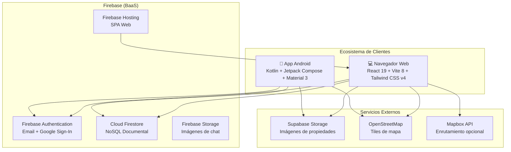

## Diagrama 5.2: Diagrama de Contexto

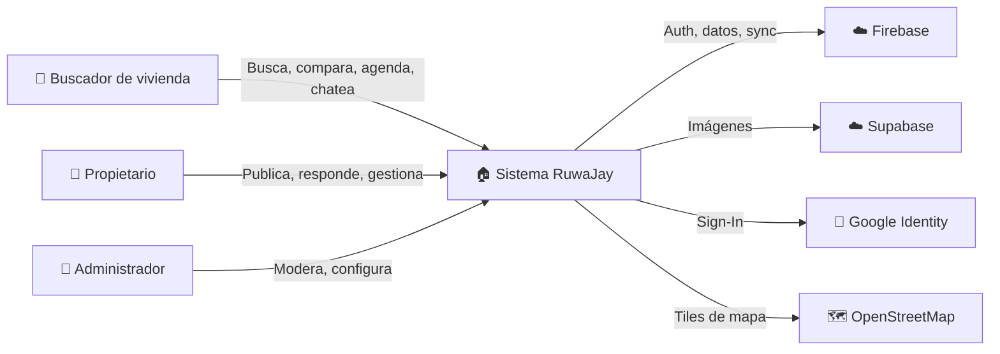

## Diagrama 5.3: Diagrama de Componentes (Web)

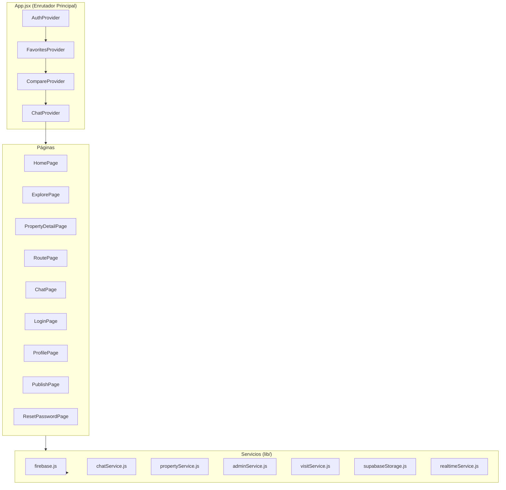

## Diagrama 5.4: Diagrama de Casos de Uso

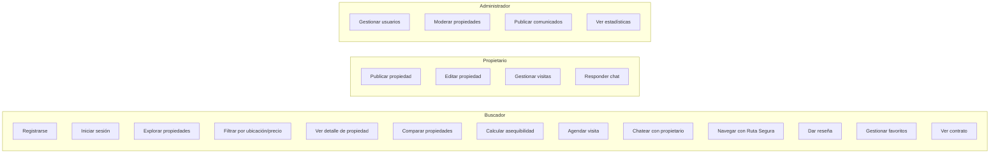

## Diagrama 5.5: Flujo de Autenticación

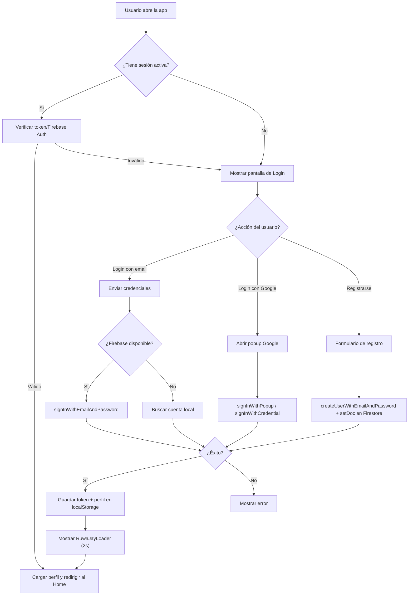

## Diagrama 5.6: Flujo de Publicación de Propiedad

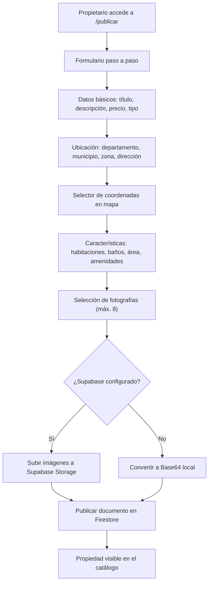

## Diagrama 5.7: Flujo de Chat en Tiempo Real

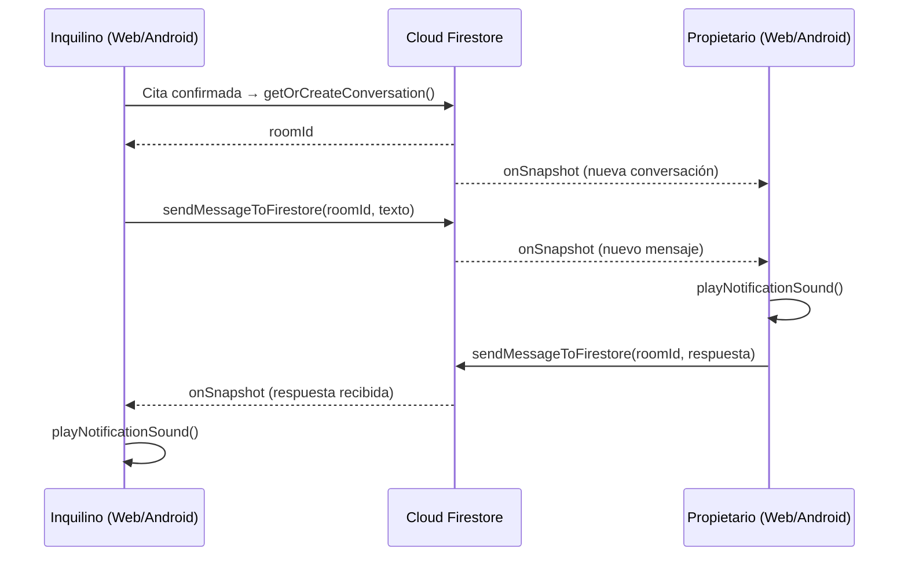

## Diagrama 5.8: Flujo de Ruta Segura

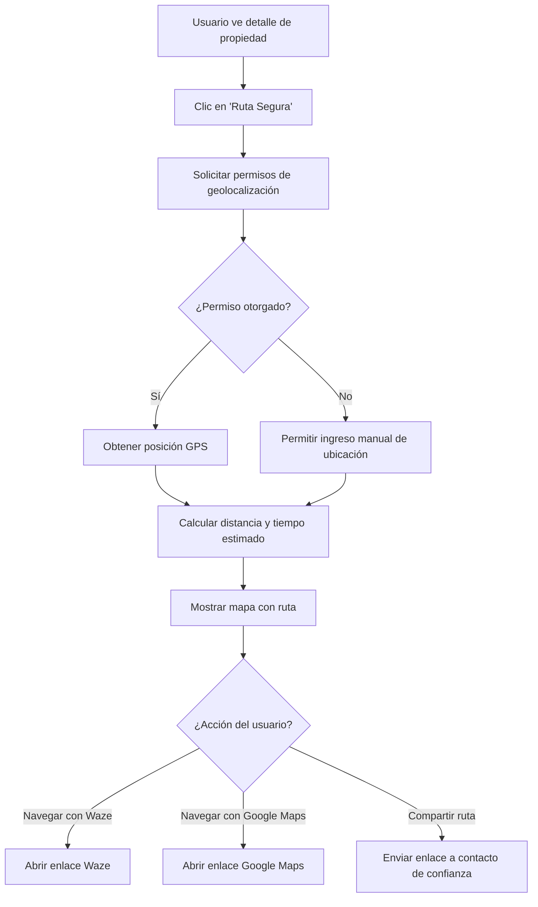

## Diagrama 5.9: Diagrama Entidad-Relación (Firestore)

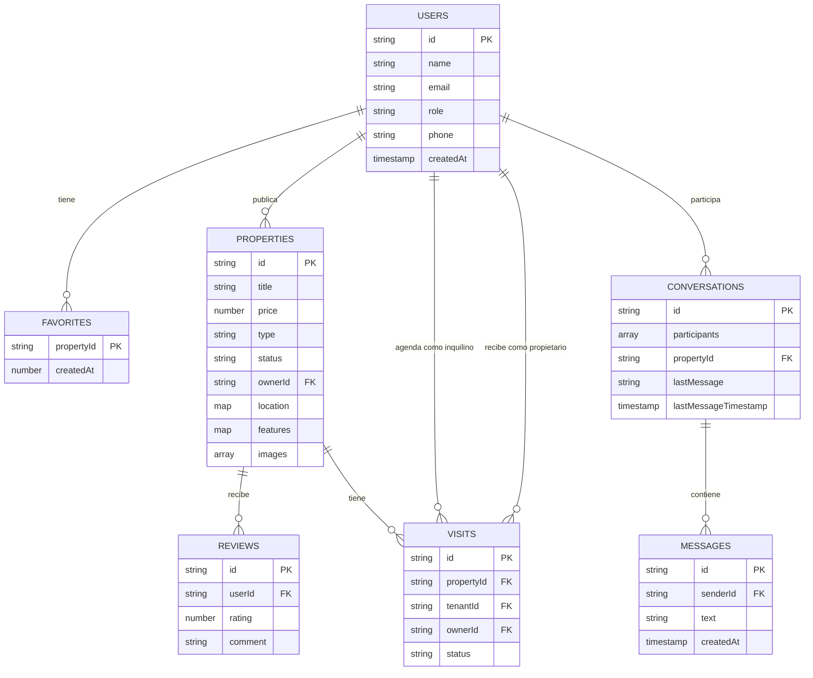

## Diagrama 5.10: Navegación Web (Rutas)

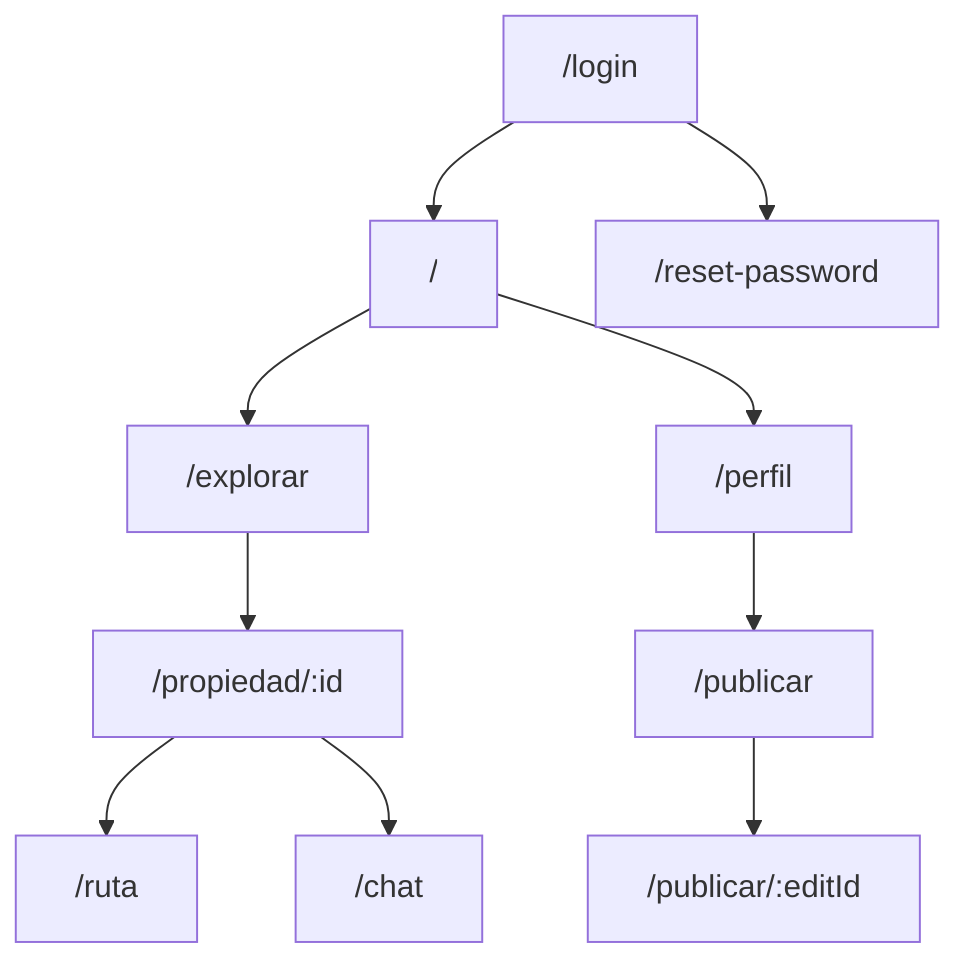

## Diagrama 5.11: Navegación Android (Screens)

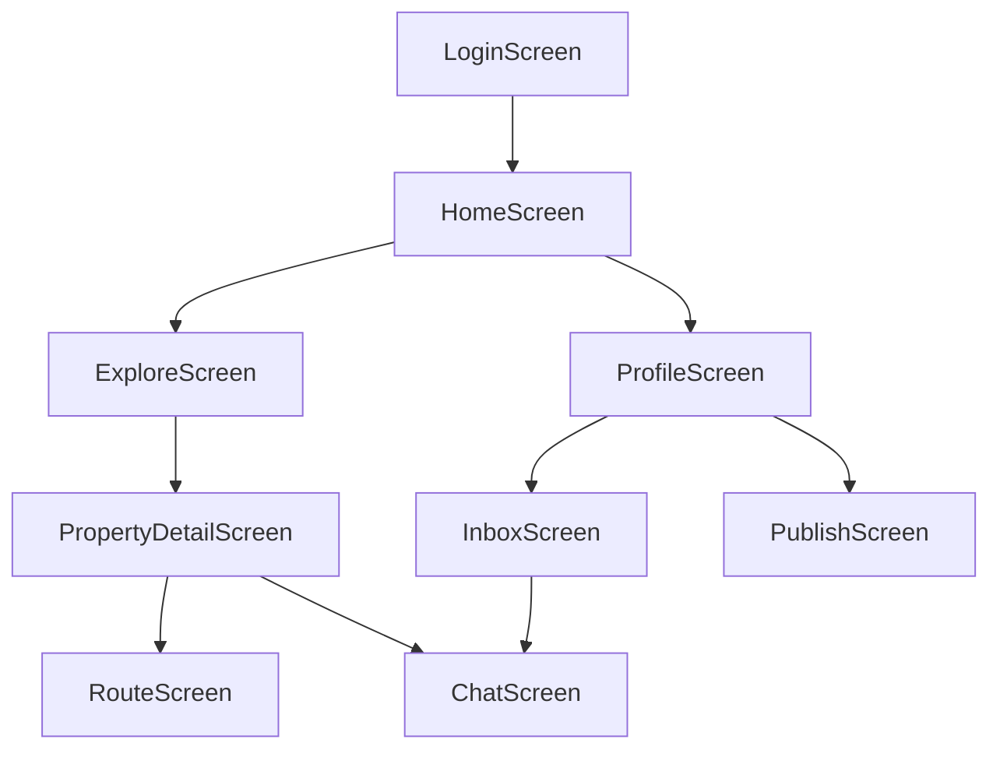

---

# CAPÍTULO VI. DOCUMENTACIÓN DE LA VERSIÓN WEB

## 6.1 Descripción general de la versión web

La aplicación web de **RuwaJay** está construida como una Single Page Application (SPA) moderna, responsiva y de alto rendimiento utilizando **React 19**, empaquetada y servida mediante **Vite 8** y estilizada con **Tailwind CSS v4**. La plataforma ofrece una experiencia inmersiva centrada en el usuario, optimizada para resoluciones móviles, tablets y monitores de escritorio. Su propósito fundamental es conectar de manera transparente y segura a personas en búsqueda de arrendamiento habitacional con propietarios de inmuebles legítimos en la República de Guatemala.

El sistema web centraliza todo el ciclo de vida del alquiler residencial:
1. **Descubrimiento y Búsqueda:** Exploración geoespacial sobre mapas interactivos basados en OpenStreetMap/Leaflet y filtrado multicriterio por división política administrativa guatemalteca (22 departamentos, municipios y zonas urbanas).
2. **Evaluación Comparativa y Financiera:** Herramientas de cálculo de asequibilidad de renta y comparador simultáneo de métricas habitacionales (precio por m², habitaciones, depósitos, costos de servicios).
3. **Formalización y Comunicación:** Mensajería bidireccional instantánea respaldada por Cloud Firestore, gestión de citas presenciales y generación automatizada de borradores de contratos de arrendamiento adaptados a la legislación civil guatemalteca.
4. **Seguridad Personal:** El módulo *Ruta Segura*, que calcula trayectos viales óptimos mediante OSRM y geolocalización satelital en tiempo real, integrando enlaces de navegación a Waze y Google Maps junto con la compartición de trayectos a contactos de emergencia.

## 6.2 Estructura y organización del frontend

El código fuente del frontend web se encuentra ubicado en la raíz del proyecto dentro del directorio `src/`, siguiendo una arquitectura modular basada en separación de responsabilidades:

```
src/
├── components/          # Componentes reutilizables clasificados por dominio
│   ├── chat/            # Componentes de mensajería (Toast de notificaciones)
│   ├── layout/          # Estructura visual global (Header, Footer, MobileNav)
│   ├── map/             # Mapas Leaflet y vistas de navegación GPS
│   ├── property/        # Tarjetas, comparador, modales de contrato, asequibilidad y reseñas
│   └── ui/              # Elementos atómicos de UI (Loaders, selects personalizados, banners)
├── context/             # Proveedores de estado global mediante React Context API
│   ├── AuthContext.jsx      # Gestión de autenticación, sesión, roles y verificación DPI
│   ├── ChatContext.jsx      # Gestión de conversaciones, mensajes y sonido Web Audio API
│   ├── CompareContext.jsx   # Estado de la bandeja de comparación de propiedades
│   └── FavoritesContext.jsx # Persistencia y sincronización de favoritos
├── data/                # Catálogos estáticos y datos semilla
│   ├── avatars.js           # Catálogo de avatares predefinidos
│   ├── guatemalaLocations.js# Dataset de 22 departamentos, municipios y zonas
│   └── properties.js        # Propiedades demostrativas y funciones auxiliares
├── hooks/               # Custom hooks reutilizables
│   └── useGeolocation.js    # Abstracción de la API Geolocation del navegador
├── lib/                 # Capa de servicios e integración con APIs externas
│   ├── adminService.js      # Operaciones CRUD para administración de usuarios y comunicados
│   ├── chatService.js       # Sincronización en tiempo real de chats vía Firestore
│   ├── firebase.js          # Inicialización y configuración de Firebase Web SDK
│   ├── propertyService.js   # Gestión de propiedades en Firestore y caché local
│   ├── realtimeService.js   # Bus de eventos CustomEvent para reactividad cliente
│   ├── supabaseStorage.js   # Carga y almacenamiento de fotografías en Supabase Storage
│   └── visitService.js      # Gestión de estados de visitas y citas
├── pages/               # Vistas principales vinculadas a rutas de navegación
│   ├── ChatPage.jsx         # Centro de mensajería en tiempo real
│   ├── ExplorePage.jsx      # Catálogo de exploración con filtros y mapa
│   ├── HomePage.jsx         # Página de aterrizaje principal
│   ├── LoginPage.jsx        # Acceso y registro con soporte Google Sign-In
│   ├── ProfilePage.jsx      # Perfil de usuario, citas, propiedades y panel admin
│   ├── PropertyDetailPage.jsx # Ficha técnica detallada del inmueble
│   ├── PublishPage.jsx      # Asistente de publicación de propiedades con mapa
│   ├── ResetPasswordPage.jsx# Restablecimiento de credenciales de acceso
│   └── RoutePage.jsx        # Asistente de desplazamiento vial y Ruta Segura
├── utils/               # Utilidades transversales
│   └── security.js          # Sanitización XSS, validación de archivos y contraseñas
├── App.jsx              # Configuración de rutas (React Router) y jerarquía de contextos
├── index.css            # Importación y configuración de variables de diseño Tailwind
├── main.jsx             # Punto de entrada de renderizado en el DOM virtual
└── style.css            # Estilos complementarios y animaciones personalizadas
```

## 6.3 Enrutamiento y navegación (React Router v7)

El enrutamiento del sistema se gestiona de forma declarativa del lado del cliente utilizando `react-router-dom` (versión 7). En `src/App.jsx`, la función `RuwaJayRoutes` encapsula las reglas de control de acceso basándose en el estado de autenticación proporcionado por `AuthContext`.

### Control de Acceso y Protección de Rutas

1. **Estado de Inicialización (`isInitializing`):** Mientras Firebase Authentication determina si existe una sesión persistente, se renderiza un spinner centrado de alta estética, evitando parpadeos visuales indeseados (FOUC) o redirecciones erróneas.
2. **Animación de Post-Autenticación (`isPostAuthLoading`):** Tras un inicio de sesión exitoso, se presenta el componente `RuwaJayLoader` durante 2 segundos, proporcionando retroalimentación de bienvenida con la identidad visual corporativa.
3. **Usuarios No Autenticados (`!user`):** Cualquier solicitud a rutas protegidas es interceptada por un comodín (`<Route path="*" element={<Navigate to="/login" replace />} />`), redirigiendo al visitante hacia `/login`. Las únicas excepciones públicas son `/login`, `/reset-password` y la URL de acción oficial de Firebase (`/__/auth/action`).
4. **Usuarios Autenticados:** Tienen acceso al conjunto completo de rutas funcionales. Si un usuario con sesión activa intenta navegar manualmente a `/login` o `/reset-password`, el enrutador lo redirige automáticamente a la página de inicio (`/`).

### Matriz de Rutas Web

| Ruta | Componente | Descripción | Nivel de Acceso |
|---|---|---|---|
| `/` | `HomePage` | Página de bienvenida, hero interactivo, catálogo destacado | Autenticado |
| `/explorar` | `ExplorePage` | Exploración de inmuebles con mapa Leaflet y filtros | Autenticado |
| `/propiedad/:id` | `PropertyDetailPage` | Vista detallada, galería, agendamiento y contratos | Autenticado |
| `/ruta` | `RoutePage` | Módulo de Ruta Segura, OSRM y geolocalización | Autenticado |
| `/chat` | `ChatPage` | Mensajería instantánea en tiempo real con propietarios | Autenticado |
| `/perfil` | `ProfilePage` | Configuración de cuenta, visitas, inmuebles y admin | Autenticado |
| `/publicar` | `PublishPage` | Asistente de publicación de nuevas propiedades | Autenticado (`owner`/`admin`) |
| `/publicar/:editId` | `PublishPage` | Modo de edición para inmuebles previamente publicados | Autenticado (propietario del inmueble) |
| `/login` | `LoginPage` | Portal de autenticación y registro de nuevas cuentas | Público |
| `/reset-password` | `ResetPasswordPage` | Formulario de cambio de contraseña con oobCode | Público |

## 6.4 Gestión de estado global (Context API)

Para gestionar el estado transversal sin incurrir en complejidad innecesaria de librerías externas de terceros (como Redux), RuwaJay aprovecha de forma exhaustiva la **Context API** de React combinada con hooks nativos (`useState`, `useEffect`, `useMemo`, `useCallback`). En `src/App.jsx`, los contextos se anidan estratégicamente:

```jsx
<AuthProvider>
  <FavoritesProvider>
    <CompareProvider>
      <ChatProvider>
        <RuwaJayRoutes />
      </ChatProvider>
    </CompareProvider>
  </FavoritesProvider>
</AuthProvider>
```

### 1. `AuthContext` (`src/context/AuthContext.jsx`)
Centraliza la identidad del usuario, los tokens de acceso y la seguridad perimetral de la sesión:
- **Estados expuestos:** `user`, `loading`, `isInitializing`, `isPostAuthLoading`, `inactivityWarning`, `inactivitySecondsLeft`.
- **Métodos expuestos:** `login(email, password)`, `register(data)`, `loginWithGoogle()`, `logout()`, `updateProfile(data)`, `changePassword(oldPw, newPw)`, `requestPasswordReset(email)`, `confirmPasswordReset(code, newPw)`, `requestVerification(dpiData)`, `purgeDpiData()`, `resetInactivity()`.
- **Mecanismo de Inactividad:** Monitorea eventos DOM globales (`mousemove`, `keydown`, `touchstart`, `scroll`). Si transcurren 15 minutos sin interacción, activa una cuenta regresiva visual de 60 segundos antes de forzar el cierre de sesión (`logout()`), previniendo secuestro de sesiones en terminales compartidas.

### 2. `FavoritesContext` (`src/context/FavoritesContext.jsx`)
Administra la lista de propiedades guardadas por el usuario:
- **Sincronización híbrida:** Si el usuario está autenticado, sincroniza las propiedades favoritas en la subcolección `users/{uid}/favorites` en Cloud Firestore.
- **Tolerancia a desconexión:** Si Firestore no está disponible o el usuario trabaja en modo demostrativo, conmuta de forma transparente hacia `localStorage` (`ruwajay_favorites`).
- **Métodos expuestos:** `favorites`, `isFavorite(id)`, `toggleFavorite(id)`, `clearFavorites()`.

### 3. `CompareContext` (`src/context/CompareContext.jsx`)
Permite la selección y cotejo paramétrico de inmuebles:
- **Capacidad:** Permite seleccionar un máximo de 3 propiedades simultáneamente.
- **Control de interfaz:** Gestiona el estado de apertura del modal flotante de comparación (`isCompareModalOpen`).
- **Métodos expuestos:** `compareList`, `addToCompare(prop)`, `removeFromCompare(id)`, `isInCompare(id)`, `toggleCompare(prop)`, `clearCompare()`, `isCompareModalOpen`, `setIsCompareModalOpen()`.

### 4. `ChatContext` (`src/context/ChatContext.jsx`)
Gobernador de la comunicación en tiempo real:
- **Suscripciones activas:** Escucha en tiempo real la colección `conversations` donde el UID del usuario figura en el arreglo `participants`.
- **Alertas Sonoras:** Implementa un generador de tonos polifónicos usando la **Web Audio API** del navegador (`playNotificationSound()`), emitiendo un timbre armónico en tono de Mi agudo (659.25 Hz) con caída exponencial cada vez que ingresa un mensaje nuevo del interlocutor.
- **Reparación de citas heredadas:** Incluye lógica de reconciliación para actualizar citas previas confirmadas con los nuevos identificadores de Firebase.

## 6.5 Catálogo exhaustivo de páginas y vistas

### 1. `HomePage.jsx` (Página de Inicio)
Es la puerta de entrada a la plataforma. Diseñada bajo un enfoque visual moderno con animaciones suaves mediante Framer Motion y GSAP.
- **Hero Section:** Mensaje de impacto que resalta el valor de la vivienda digna en Guatemala, con un buscador rápido integrado con autocompletado de departamentos y zonas urbanas.
- **Sección de Propiedades Destacadas:** Carrusel reactivo que filtra inmuebles verificados con alta calificación.
- **Beneficios del Ecosistema:** Módulos informativos que exponen las ventajas clave: *Ruta Segura*, *Calculadora Financiera*, *Chat en Tiempo Real* y *Contratos Formalizados*.
- **Testimonios e Identidad:** Valoraciones de usuarios de la comunidad y enlaces a la descarga de la aplicación Android nativa mediante un banner flotante interactivo.

### 2. `ExplorePage.jsx` (Explorador de Propiedades)
Constituye el núcleo analítico de búsqueda de vivienda:
- **Barra de Filtrado Multicriterio:** Permite filtrar instantáneamente por departamento, municipio, zona, tipo de propiedad (`casa` o `apartamento`), rango dinámico de precios (GTQ), habitaciones mínimas, baños mínimos y amenidades (garita de seguridad, parqueo, cisterna, aceptación de mascotas).
- **Conmutador de Visualización:** Permite alternar con un solo clic entre tres modos de visualización:
  1. *Vista de Cuadrícula (Grid):* Tarjetas visuales organizadas con imágenes grandes, insignias de verificación y precio destacado.
  2. *Vista de Lista (List):* Formato horizontal condensado, ideal para comparar descripciones técnicas y áreas en metros cuadrados.
  3. *Vista de Mapa (Map):* Integración de `MapView.jsx` que ubica los inmuebles geográficamente con pines personalizados e información en popups emergentes.
- **Persistencia de Filtros:** Mantiene los criterios de búsqueda en la URL mediante `URLSearchParams`, permitiendo compartir búsquedas exactas mediante enlaces directos.

### 3. `PropertyDetailPage.jsx` (Ficha Técnica de Propiedad)
Es la página con mayor densidad funcional del sistema (más de 1,100 líneas de código):
- **Galería Multimedia y Lightbox:** Muestra las fotografías organizadas por zonas (Fachada, Sala, Cocina, Dormitorios). Al hacer clic en cualquier imagen, se abre el componente `PropertyLightbox` para inspección en pantalla completa con controles de zoom y navegación.
- **Ficha Descriptiva y Financiera:** Detalla el canon mensual de arrendamiento, depósito de garantía, costos estimados de servicios públicos y desglose del área construida.
- **Integración con Modales Especializados:**
  - *Calculadora de Asequibilidad:* Abre `RentAffordabilityModal` transfiriendo el precio del inmueble actual para evaluar si se ajusta a las finanzas del usuario.
  - *Generador de Contrato:* Abre `LeaseContractModal` precargando los datos del propietario, inquilino y dirección para generar el borrador legal.
  - *Agendamiento de Citas:* Despliega un selector de fecha (`RuwaDatePicker`) y horario para solicitar una visita presencial formal.
- **Comunicación Directa:** Botón inteligente para abrir chat en tiempo real si existe una cita aprobada, o enlace directo a WhatsApp con mensaje estructurado de consulta previa.
- **Reseñas y Calificaciones:** Muestra `PropertyReviews` con desglose de estrellas por 5 categorías clave (limpieza, veracidad, comunicación, ubicación y precio).
- **Ruta Segura:** Acceso directo a `RoutePage` pasando el ID de la propiedad para trazar la ruta de navegación GPS desde la ubicación actual.

### 4. `RoutePage.jsx` (Módulo de Ruta Segura)
Proporciona seguridad integral al usuario durante sus traslados presenciales a los inmuebles:
- **Geolocalización Automática:** Invoca `useGeolocation` para adquirir las coordenadas GPS del dispositivo con alta precisión (`enableHighAccuracy: true`).
- **Cálculo de Rutas OSRM (Open Source Routing Machine):** Calcula la distancia métrica real y el tiempo estimado de viaje (ETA) considerando la red de calles transitables, diferenciando entre modos de transporte vehicular (`driving`) y peatonal (`walking`).
- **Navegadores Externos:** Botones de un toque con esquemas universales para transferir el destino directamente a las aplicaciones nativas de **Waze** (`https://waze.com/ul?ll=...&navigate=yes`) y **Google Maps** (`https://www.google.com/maps/dir/?api=1&destination=...`).
- **Botón de Emergencia y Compartir Trayecto:** Permite copiar un enlace seguro para compartir por WhatsApp o SMS con familiares, informando qué inmueble se visitará, coordenadas exactas y hora estimada de llegada.

### 5. `ChatPage.jsx` (Centro de Mensajería Instantánea)
Interfaz de mensajería bidireccional construida sobre Cloud Firestore:
- **Diseño Adaptativo Responsive:** En pantallas móviles ofrece navegación fluida entre la lista de conversaciones y el hilo de mensajes activo mediante transiciones deslizantes.
- **Indicadores de Estado:** Muestra doble verificación de entrega (`CheckCheck`), marcas temporales formateadas y el estado de lectura de los mensajes.
- **Adjuntos Multimedia:** Permite el envío de fotografías directamente en la conversación, procesándolas mediante validación de seguridad MIME y almacenamiento en la nube.
- **Simulación de Llamada:** Proporciona un modal interactivo de comunicación de voz con contador de duración para coordinar detalles urgentes.

### 6. `LoginPage.jsx` (Autenticación y Registro)
Portal unificado de acceso con diseño limpio y robusto:
- **Pestañas de Acción:** Alternancia fluida entre formulario de inicio de sesión y formulario de registro.
- **Registro Detallado:** Captura nombre completo, correo electrónico, contraseña, confirmación de contraseña, número de teléfono y selección obligatoria de rol (`seeker` o `owner`).
- **Autenticación con Google:** Botón de un solo clic que utiliza `signInWithPopup` de Firebase para validar identidades mediante cuentas Google institucionales o personales.
- **Medidor de Seguridad de Contraseña:** Evalúa en tiempo real 5 reglas de complejidad criptográfica (longitud mínima de 8 caracteres, mayúsculas, minúsculas, números y caracteres especiales) mediante indicadores visuales de color.

### 7. `ProfilePage.jsx` (Panel del Usuario y Administración)
Es la vista más extensa de la aplicación (cerca de 2,900 líneas de código), adaptando dinámicamente sus pestañas según el rol del usuario conectado:
- **Para Buscadores (`seeker`):**
  - *Mis Favoritos:* Cuadrícula de inmuebles guardados con acceso inmediato a detalles o descarte.
  - *Mis Citas Solicitadas:* Historial cronológico de visitas solicitadas con estados (`pendiente`, `confirmada`, `rechazada`, `cancelada`). Si la cita está confirmada, habilita el botón de acceso al chat con el propietario.
  - *Verificación de Identidad (DPI):* Formulario para ingresar el CUI (13 dígitos) guatemalteco, departamento de emisión y fotografía del documento físico. Incluye botón de purga definitiva para derecho al olvido y privacidad de datos.
- **Para Propietarios (`owner`):**
  - *Mis Propiedades:* Catálogo de inmuebles publicados con opción de cambiar estado operativo (`disponible`, `en_cita`, `reservada`, `alquilada`, `pausada`), editar información o eliminar la publicación.
  - *Gestión de Citas Recibidas:* Bandeja de solicitudes de visita donde el propietario puede confirmar citas, proponer reprogramaciones o rechazarlas.
- **Para Administradores (`admin`):**
  - *Gestión de Usuarios:* Tabla sincronizada en tiempo real que lista todas las cuentas del sistema, permitiendo cambiar roles (`seeker`, `owner`, `admin`) y suspender o reactivar cuentas (`active` / `suspended`).
  - *Comunicados del Sistema:* Módulo para redactar anuncios globales (`system_updates`) con prioridades (baja, media, alta, urgente) que se notifican a todos los usuarios.
  - *Métricas Globales:* Panel de analítica que totaliza usuarios registrados, inmuebles en catálogo, citas generadas y mensajes intercambiados.

### 8. `PublishPage.jsx` (Asistente de Publicación de Propiedades)
Formulario estructurado en pasos secuenciales que guía al propietario en la publicación de su inmueble:
- **Paso 1: Información Básica:** Título descriptivo, tipo de inmueble (`casa` / `apartamento`), canon de renta mensual y depósito en Quetzales (GTQ).
- **Paso 2: Localización Precisa:** Selección jerárquica de departamento, municipio y zona guatemalteca, complementada con el mapa interactivo `PropertyLocationPickerMap` que permite colocar un pin exacto en las coordenadas deseadas.
- **Paso 3: Características y Servicios:** Selector numérico de habitaciones, baños, parqueos, área en m², reglas de convivencia y checklist de amenidades y servicios básicos incluidos.
- **Paso 4: Carga y Optimización de Fotografías:** Admite hasta 8 fotografías. Implementa compresión del lado del cliente (`compressAndReadImage`) mediante Canvas HTML5 para optimizar el peso antes de subirlas a Supabase Storage.

### 9. `ResetPasswordPage.jsx` (Restablecimiento de Credenciales)
Maneja el flujo de recuperación de cuentas:
- Procesa el parámetro `oobCode` enviado por Firebase en los enlaces de restablecimiento por correo.
- Valida la validez temporal del código y permite establecer una nueva contraseña cumpliendo las directivas de seguridad.

## 6.6 Componentes reutilizables

### Módulo Layout
- **`Header.jsx`:** Barra de navegación superior con logotipo corporativo `RuwaJayLogo`, enlaces de navegación principal, selector de notificaciones y menú desplegable del perfil de usuario con indicador del rol activo.
- **`Footer.jsx`:** Pie de página institucional con enlaces legales, información de contacto guatemalteco, descargo de responsabilidad y enlaces al ecosistema móvil.
- **`MobileNav.jsx`:** Barra de navegación inferior fija para teléfonos móviles, ofreciendo accesos directos táctiles a Inicio, Explorar, Publicar, Chat y Perfil.

### Módulo Map
- **`MapView.jsx`:** Contenedor de mapas Leaflet (`react-leaflet`) configurado con capas de teselas OpenStreetMap. Maneja clústeres de pines, íconos personalizados de casas/apartamentos y popups interactivos.
- **`PropertyLocationPickerMap.jsx`:** Componente de mapa con listener de eventos de clic para captura de latitud y longitud al momento de publicar un inmueble.
- **`RuwaJayNavigationView.jsx`:** Visualizador de ruta vial interactiva con polilíneas decodificadas y cálculo de distancias sobre el mapa.

### Módulo Property
- **`PropertyCard.jsx`:** Tarjeta visual estandarizada para mostrar inmuebles. Incluye carrusel de imágenes rápido, botón de favoritos con microanimación, etiquetas de verificación y resumen de amenidades.
- **`PropertyCompareModal.jsx`:** Ventana emergente modal que compara hasta 3 inmuebles seleccionados lado a lado, contrastando precio, área, habitaciones, baños y ubicación.
- **`LeaseContractModal.jsx`:** Generador dinámico de contratos de arrendamiento según el Código Civil de Guatemala. Permite imprimir o descargar el documento formateado legalmente.
- **`RentAffordabilityModal.jsx`:** Herramienta interactiva de salud financiera. El usuario ingresa sus ingresos mensuales netos y el sistema calcula la regla recomendada del 30% para determinar si el inmueble representa una carga financiera saludable.
- **`PropertyReviews.jsx`:** Componente de retroalimentación comunitaria con formulario de reseña y promedios desagregados.

### Módulo UI
- **`RuwaJayLoader.jsx`:** Pantalla de carga estética con el imagotipo animado de RuwaJay y mensajes de estado contextuales.
- **`RuwaSelect.jsx`:** Componente desplegable personalizado y accesible, adaptado al sistema de diseño.
- **`RuwaDatePicker.jsx`:** Selector de calendario adaptado para la selección intuitiva de fechas de visitas presenciales.
- **`ErrorBoundary.jsx`:** Componente de contención de fallos React que captura errores de renderizado en tiempo de ejecución, impidiendo que la aplicación colapse completamente.
- **`ChatNotificationToast.jsx`:** Notificación flotante emergente que avisa al usuario sobre nuevos mensajes cuando se encuentra en otras secciones de la plataforma.

## 6.7 Servicios de infraestructura frontend (`src/lib/`)

1. **`firebase.js`:** Inicializa la aplicación Firebase mediante `initializeApp()`, exportando instancias configuradas de `firebaseAuth`, `firestore` y `firebaseStorage`. Incluye banderas booleanas de disponibilidad (`firebaseWebEnabled`).
2. **`propertyService.js`:** Encapsula la interacción con la colección `properties` de Firestore. Implementa `subscribeToProperties` mediante `onSnapshot` para reactividad en tiempo real, `publishPropertyToFirebase`, `updatePropertyToFirebase` y `deleteOwnedProperty`. Incluye normalización de datos (`normalizeFirebaseProperty`) para compatibilidad retroactiva con datos de prueba.
3. **`chatService.js`:** Provee `getOrCreateConversation` (garantizando identificadores deterministas basados en los UIDs y el inmueble), `subscribeToConversations`, `subscribeToMessages` y `sendMessageToFirestore`.
4. **`visitService.js`:** Gestiona el ciclo de vida de las visitas en la colección `visits`, implementando creación de citas (`createVisit`), cambios de estado (`changeVisitStatus`), y suscripciones por usuario (`subscribeToUserVisits`).
5. **`adminService.js`:** Provee funciones privilegiadas para el panel de administración: `subscribeToUsers`, `updateUserRole`, `updateUserStatus`, y gestión completa de comunicados (`subscribeToSystemUpdates`, `createSystemUpdate`, `deleteSystemUpdate`).
6. **`supabaseStorage.js`:** Administra la carga directa de fotografías hacia un bucket de Supabase Storage mediante peticiones HTTP REST multipart con autenticación mediante API Key, evitando sobrecargar la base de datos Firestore con cadenas Base64.
7. **`realtimeService.js`:** Implementa un bus de eventos reactivo del lado del cliente utilizando la API `CustomEvent` de JavaScript (`window.dispatchEvent` y `window.addEventListener`) para propagar cambios de favoritos y estado sin acoplar componentes.

## 6.8 Hooks personalizados

### `useGeolocation.js` (`src/hooks/useGeolocation.js`)
Abstrae la complejidad de la API de Geolocalización nativa de los navegadores:
- **Funcionalidad:** Solicita coordenadas GPS con alta precisión (`enableHighAccuracy: true`, `timeout: 10000`, `maximumAge: 300000`).
- **Retorno:** Provee un objeto `{ position: { lat, lng }, loading, error, requestPosition }`.
- **Manejo de Errores:** Captura denegaciones de permisos, timeouts y fallos de hardware, ofreciendo estados claros para que la interfaz muestre alternativas de ingreso manual.

## 6.9 Sistema de diseño y estilos

RuwaJay adopta una identidad visual basada en la calidez de la tierra y la naturaleza de Guatemala, integrando una paleta cromática personalizada en Tailwind CSS v4:

| Token de Color | Valor Hexadecimal | Significado y Aplicación |
|---|---|---|
| `crema` | `#FAF5EE` / `#F8F3EC` | Fondo principal suave que reduce la fatiga visual |
| `cafe` | `#2D231E` / `#3E3228` | Color principal de tipografía y contraste estructurado |
| `forest` | `#244E3D` / `#1E4032` | Verde bosque guatemalteco para botones principales y estados de éxito |
| `terracota` | `#C85A32` / `#B84A28` | Acentos cálidos, precios destacados y llamados a la acción (CTA) |
| `dorado` | `#D4A373` / `#E9C46A` | Insignias de verificación, estrellas de calificación y distinciones |

El sistema emplea tipografías sans-serif modernas con jerarquía visual estricta, bordes suavemente redondeados (`rounded-2xl` y `rounded-3xl`), sombras sutiles con elevación multicapa y efectos de desenfoque de fondo (*glassmorphism* mediante `backdrop-blur-md`).

## 6.10 Medidas de seguridad y optimización web

1. **Sanitización de Entradas (XSS):** Implementada en `src/utils/security.js` mediante la función `sanitizeText()`, que neutraliza caracteres peligrosos (`<`, `>`, `"`, `'`, `/`) e impide la inyección de etiquetas de script o atributos maliciosos en descripciones de propiedades o chats.
2. **Validación de Archivos:** La función `validateImageFile()` comprueba estrictamente el tipo MIME (`image/jpeg`, `image/png`, `image/webp`), la extensión del archivo y que el peso no exceda los 8 MB permitidos.
3. **Cabeceras HTTP Seguras:** Configuradas en el servidor de desarrollo Vite (`vite.config.js`) y en producción con Nginx:
   - `X-Content-Type-Options: nosniff`
   - `X-Frame-Options: SAMEORIGIN`
   - `X-XSS-Protection: 1; mode=block`
   - `Referrer-Policy: strict-origin-when-cross-origin`
4. **Code Splitting y Lazy Loading:** El componente de mapa `MapView` y recursos pesados se importan mediante `React.lazy()` y `Suspense`, reduciendo drásticamente el tamaño del paquete inicial de JavaScript (*bundle size*) y acelerando el First Contentful Paint (FCP).

---

# CAPÍTULO VII. DOCUMENTACIÓN DE LA APLICACIÓN ANDROID

## 7.1 Descripción general de la aplicación móvil

La aplicación móvil de **RuwaJay** es una solución nativa para el sistema operativo Android, desarrollada íntegramente en **Kotlin** utilizando el toolkit declarativo moderno **Jetpack Compose** y el sistema de diseño **Material Design 3**. La aplicación ha sido concebida para ofrecer paridad funcional casi total con la versión web, brindando una experiencia rápida, fluida y con acceso nativo al hardware del dispositivo móvil.

El cliente móvil se comunica directamente con la misma infraestructura en la nube que la aplicación web (Cloud Firestore, Firebase Authentication y Supabase Storage), asegurando que cualquier propiedad publicada desde la web aparezca instantáneamente en la aplicación Android y viceversa, garantizando sincronización en tiempo real.

## 7.2 Estructura y arquitectura de la solución Android

La aplicación Android adopta la **Single-Activity Architecture** (Arquitectura de Actividad Única) recomendada por Google, combinada con principios de **Clean Architecture** y el patrón **Repository**:

```
android-app/app/src/main/
├── AndroidManifest.xml          # Configuración del paquete, permisos y deep links
└── java/com/example/ruwajay/
    ├── MainActivity.kt          # Actividad principal contenedora del Scaffold y NavHost
    ├── data/
    │   ├── model/               # Clases de datos (Data Classes) de dominio
    │   │   ├── Chat.kt          # Modelos de mensajes y conversaciones
    │   │   ├── Owner.kt         # Información del propietario del inmueble
    │   │   ├── Property.kt      # Modelo detallado de propiedad y filtros
    │   │   ├── Review.kt        # Modelo de reseñas y valoraciones
    │   │   └── SystemUpdate.kt  # Modelo de anuncios y comunicados del sistema
    │   └── repository/          # Abstracción de fuentes de datos (Firestore / Mock)
    │       ├── AuthRepository.kt       # Autenticación con Firebase y Google
    │       ├── ChatRepository.kt       # Sincronización de chats y envío de fotos
    │       ├── MockDataRepository.kt   # Datos de prueba para contingencia fuera de línea
    │       ├── PropertyRepository.kt   # Consultas reactivas de inmuebles y subida a Supabase
    │       ├── SystemUpdatesRepository.kt # Suscripción a comunicados de la plataforma
    │       └── VisitRepository.kt      # Gestión de visitas agendadas
    └── ui/
        ├── components/          # Componentes visuales reutilizables de Compose
        │   ├── BottomNavBar.kt         # Barra de navegación inferior animada
        │   ├── OsmLocationPickerMap.kt # Selector interactivo de coordenadas sobre OSM
        │   ├── OsmMapView.kt           # Visualizador de mapas nativo con osmdroid
        │   ├── PropertyCard.kt         # Tarjeta de inmueble en Compose
        │   ├── PropertyCompareDialog.kt# Cuadro de diálogo de comparación paramétrica
        │   ├── PropertyReviews.kt      # Componente de reseñas y calificaciones
        │   └── RentCalculatorDialog.kt # Calculadora financiera de asequibilidad de renta
        ├── navigation/          # Enrutamiento declarativo
        │   ├── AppNavigation.kt        # Definición del NavHost y deep links
        │   └── Screen.kt               # Sealed class de rutas y argumentos
        ├── screens/             # Pantallas completas de la interfaz
        │   ├── ChatScreen.kt           # Pantalla de chat activo
        │   ├── ExploreScreen.kt        # Explorador con filtros y mapa nativo
        │   ├── HomeScreen.kt           # Pantalla principal con destacados
        │   ├── InboxScreen.kt          # Bandeja de entrada de mensajes
        │   ├── LoginScreen.kt          # Acceso y registro móvil
        │   ├── ProfileScreen.kt        # Perfil de usuario y citas
        │   ├── PropertyDetailScreen.kt # Ficha detallada de propiedad
        │   ├── PublishScreen.kt        # Asistente de publicación de propiedades
        │   └── RouteScreen.kt          # Ruta Segura y navegación GPS nativa
        └── theme/               # Sistema de diseño Material 3
            ├── Color.kt                # Paleta cromática corporativa
            ├── Theme.kt                # Configuración de RuwaJayTheme
            └── Type.kt                 # Escala tipográfica
```

## 7.3 Configuración de compilación y dependencias

El proyecto se gestiona mediante **Gradle con Kotlin DSL (`build.gradle.kts`)**. Los parámetros clave de configuración del SDK son:
- **`compileSdk` / `targetSdk`:** 35 (Android 15), asegurando compatibilidad con los estándares más recientes de seguridad y privacidad del sistema operativo.
- **`minSdk`:** 24 (Android 7.0 Nougat), garantizando cobertura en más del 95% de los dispositivos Android activos en el mercado guatemalteco.
- **`versionCode`:** 1 | **`versionName`:** "1.0.0"

### Principales Dependencias Utilizadas

| Dependencia / Biblioteca | Propósito Técnico |
|---|---|
| `androidx.compose.material3:material3` | Componentes visuales basados en la especificación Material 3 |
| `androidx.navigation:navigation-compose:2.8.5` | Navegación declarativa entre pantallas de Compose |
| `com.google.firebase:firebase-bom:33.7.0` | Gestión unificada de versiones del SDK de Firebase |
| `com.google.firebase:firebase-auth-ktx` | Autenticación nativa de usuarios |
| `com.google.firebase:firebase-firestore-ktx` | Base de datos NoSQL reactiva en tiempo real |
| `com.google.firebase:firebase-storage-ktx` | Carga de archivos y fotos de chat |
| `io.coil-kt:coil-compose:2.7.0` | Carga asíncrona, decodificación y almacenamiento en caché de imágenes |
| `org.osmdroid:osmdroid-android:6.1.20` | Mapas basados en OpenStreetMap sin dependencia de Google Play Services |
| `com.google.android.gms:play-services-location:21.3.0` | Adquisición precisa de coordenadas GPS mediante Fused Location Provider |
| `androidx.credentials:credentials:1.3.0` | API moderna de credenciales de Android para Google Sign-In |

## 7.4 Navegación declarativa y Deep Linking

La navegación se define en `AppNavigation.kt` mediante un `NavHost` central gobernado por un `NavHostController`. 

### Definición de Rutas (`Screen.kt`)
Se utiliza una `sealed class Screen` que asegura tipado estricto en las rutas:
```kotlin
sealed class Screen(val route: String) {
    object Home : Screen("home")
    object Explore : Screen("explore")
    object PropertyDetail : Screen("property_detail/{id}") {
        fun createRoute(id: String) = "property_detail/$id"
    }
    object Route : Screen("route/{propertyId}") {
        fun createRoute(propertyId: String) = "route/$propertyId"
    }
    object Chat : Screen("chat/{roomId}") {
        fun createRoute(roomId: String) = "chat/$roomId"
    }
    object Inbox : Screen("inbox")
    object Login : Screen("login")
    object Profile : Screen("profile")
    object Publish : Screen("publish")
}
```

### Soporte Exhaustivo para Deep Links
En `AndroidManifest.xml` y `AppNavigation.kt`, cada ruta fundamental cuenta con soporte para enlaces profundos personalizados y URLs estándar web. Esto permite que un usuario que reciba un enlace por WhatsApp o correo pueda abrirlo directamente en la aplicación Android nativa:
- `ruwajay://home` y `https://ruwajay.com` → `HomeScreen`
- `ruwajay://explore` y `https://ruwajay.com/explorar` → `ExploreScreen`
- `ruwajay://property/{id}` y `https://ruwajay.com/propiedad/{id}` → `PropertyDetailScreen`
- `ruwajay://route/{id}` y `https://ruwajay.com/ruta?property={id}` → `RouteScreen`
- `ruwajay://chat/{roomId}` → `ChatScreen`

## 7.5 Catálogo detallado de pantallas (Screens)

### 1. `HomeScreen.kt`
Punto de encuentro inicial del usuario en Android:
- **Barra Superior Personalizada:** Saludo con el nombre del usuario autenticado y avatar circular cargado mediante Coil.
- **Buscador Rápido:** Campo de texto interactivo con accesos directos por departamentos populares (Guatemala, Sacatepéquez, Quetzaltenango).
- **Lista de Inmuebles Destacados:** `LazyRow` horizontal de desplazamiento suave que presenta las propiedades verificadas mediante `PropertyCard`.
- **Acceso a Funcionalidades Clave:** Botones de acceso rápido para la Calculadora de Asequibilidad y la navegación a Explorar.

### 2. `ExploreScreen.kt`
Centro de descubrimiento móvil de inmuebles:
- **Selector de Filtros Desplegable:** Permite ajustar departamento, tipo de inmueble (`Casa` / `Apartamento`), y límite máximo de precio mediante un control deslizante (`Slider`).
- **Alternador de Vista Lista / Mapa:** Permite conmutar entre una lista vertical optimizada (`LazyColumn`) y la vista de mapa interactivo (`OsmMapView`).
- **Pines Interactivos en Mapa:** Utiliza marcadores personalizados de osmdroid con listener táctil para abrir la ficha de la propiedad.

### 3. `PropertyDetailScreen.kt`
Presentación técnica completa de una propiedad específica:
- **Carrusel de Fotos Nativo:** Implementado con `HorizontalPager` de Compose, permitiendo deslizamiento táctil entre las fotografías del inmueble.
- **Insignias y Métricas Clave:** Etiquetas visuales de precio en Quetzales (GTQ), depósito, habitaciones, baños y metros cuadrados construidos.
- **Acciones Rápidas:**
  - *Solicitar Visita:* Despliega un diálogo nativo para seleccionar fecha y hora de visita presencial.
  - *Iniciar Conversación:* Consulta `ChatRepository` para obtener o crear la conversación en Firestore y navega a `ChatScreen`.
  - *Ruta Segura:* Navega a `RouteScreen` para iniciar el trazado de navegación vial.
  - *Comparar:* Agrega la propiedad al diálogo `PropertyCompareDialog`.

### 4. `RouteScreen.kt` (Ruta Segura Móvil)
Módulo de seguridad y navegación en la aplicación Android:
- **Integración con Hardware GPS:** Utiliza `LocationServices.getFusedLocationProviderClient` para solicitar la posición geográfica precisa del dispositivo en tiempo real.
- **Visualizador de Trayecto:** Dibuja la ruta geográfica sobre el mapa de osmdroid conectando la ubicación actual del usuario con las coordenadas del inmueble.
- **Acceso a Navegadores Nativos:** Dispara `Intent` implícitos de Android para lanzar directamente las aplicaciones de **Waze** (`geo:...`) o **Google Maps** (`google.navigation:q=...`).
- **Compartir Ruta:** Invoca el `Intent.ACTION_SEND` nativo de Android con un mensaje estructurado que incluye las coordenadas y datos de la propiedad para compartir vía WhatsApp, Telegram o SMS con contactos de emergencia.

### 5. `InboxScreen.kt` y `ChatScreen.kt`
Centro de mensajería móvil en tiempo real:
- **`InboxScreen`:** Lista vertical con todas las conversaciones del usuario, mostrando foto del inmueble, último mensaje recibido, fecha relativa y estado de lectura.
- **`ChatScreen`:** Interfaz de mensajería con burbujas diferenciadas por remitente (usuario vs. propietario). Incluye campo de texto, botón para adjuntar fotografías desde la galería del teléfono mediante el selector `rememberLauncherForActivityResult(ActivityResultContracts.GetContent())`, y escucha reactiva en tiempo real mediante `addSnapshotListener` de Firestore.

### 6. `LoginScreen.kt`
Portal de autenticación móvil:
- Campos de texto Material 3 con validación en tiempo real para correo electrónico y contraseña.
- Botón de inicio de sesión con Google integrado mediante la API de Credenciales de Google Play Services.
- Alternador hacia registro de nuevos usuarios con selección de rol (`seeker` o `owner`).

### 7. `ProfileScreen.kt`
Panel personal del usuario móvil:
- Información de la cuenta activa (nombre, correo electrónico, rol asignado).
- Gestión de visitas agendadas (ver estados confirmados o pendientes).
- Acceso directo a la publicación de propiedades para usuarios con rol de propietario.
- Botón de cierre seguro de sesión que limpia el estado de `FirebaseAuth` y redirige a `LoginScreen`.

### 8. `PublishScreen.kt`
Asistente móvil para la publicación de inmuebles:
- Formulario dividido en secciones: datos comerciales, ubicación geográfica con selector en mapa (`OsmLocationPickerMap`), amenidades y selección de fotografías desde la memoria del teléfono.
- Procesamiento en segundo plano que sube las imágenes hacia Supabase Storage y registra el documento correspondiente en Cloud Firestore.

## 7.6 Componentes reutilizables de interfaz móvil

1. **`BottomNavBar.kt`:** Barra de navegación inferior que resalta el destino activo con animación de pastilla indicadora de Material 3. Permite transitar fluidamente entre Home, Explorar, Publicar, Mensajes y Perfil.
2. **`PropertyCard.kt`:** Tarjeta visual construida con `Card` y `ElevatedCard`. Presenta imagen principal procesada por Coil con bordes redondeados, precio formateado, título del inmueble, ubicación en zona/departamento y resumen de habitaciones/baños.
3. **`OsmMapView.kt`:** Componente wrapper que embebe la vista clásica de `org.osmdroid.views.MapView` dentro de la jerarquía de Jetpack Compose utilizando `AndroidView`. Configura tiles de OpenStreetMap, controles de zoom multitáctiles y clústeres de marcadores.
4. **`OsmLocationPickerMap.kt`:** Selector interactivo de coordenadas para la pantalla de publicación. Permite al usuario arrastrar el mapa y pulsar sobre un punto específico para obtener la latitud y longitud exactas.
5. **`RentCalculatorDialog.kt`:** Diálogo flotante modal que implementa el cálculo de asequibilidad de renta del 30% en Compose.
6. **`PropertyCompareDialog.kt`:** Cuadro de diálogo que renderiza una tabla comparativa horizontal entre dos o más inmuebles seleccionados.

## 7.7 Capa de datos y arquitectura de repositorios

La aplicación Android desacopla la interfaz gráfica del acceso a datos mediante repositorios dedicados:

- **`PropertyRepository.kt`:** Expone la función composable `rememberProperties()` que mantiene una lista reactiva actualizada mediante un `addSnapshotListener` sobre la colección `properties` de Firestore. Si la conexión falla o el dispositivo está desconectado, conmuta automáticamente a los datos provistos por `MockDataRepository.kt`. También implementa `publishProperty()`, que orquesta la subida HTTP a Supabase Storage y el registro en Firestore.
- **`ChatRepository.kt`:** Gestiona el ciclo de vida de los mensajes en tiempo real. Provee `observeConversations()` para escuchar la bandeja de entrada, `getOrCreateConversation()` para inicializar salas de conversación y `sendMessage()` para añadir documentos a la subcolección `messages`.
- **`AuthRepository.kt`:** Abstrae las llamadas a `FirebaseAuth`, proveyendo métodos asíncronos para registro, inicio de sesión tradicional y autenticación mediante credenciales de Google (`GoogleAuthProvider`).
- **`VisitRepository.kt`:** Administra las solicitudes de visitas y la sincronización de citas presenciales en la colección `visits`.
- **`SystemUpdatesRepository.kt`:** Escucha en tiempo real la colección `system_updates` para mostrar notificaciones urgentes o anuncios generales emitidos por los administradores.

## 7.8 Modelos de datos Kotlin

Los modelos de datos de Android están diseñados como `data class` inmutables en el paquete `com.example.ruwajay.data.model`:

```kotlin
data class Property(
    val id: String,
    val title: String,
    val description: String,
    val price: Int,
    val deposit: Int,
    val currency: String = "Q",
    val type: String, // "casa" o "apartamento"
    val status: String = "disponible",
    val ownerId: String,
    val ownerName: String,
    val ownerEmail: String,
    val ownerPhone: String,
    val features: PropertyFeatures,
    val location: Location,
    val images: List<String>,
    val amenities: List<String>,
    val rules: List<String>,
    val requirements: List<String>,
    val verified: Boolean = false
)

data class PropertyFeatures(
    val bedrooms: Int,
    val bathrooms: Int,
    val area: Int,
    val parking: Int
)

data class Location(
    val department: String,
    val municipality: String,
    val zone: String,
    val address: String,
    val coordinates: Coordinates?
)

data class Coordinates(val lat: Double, val lng: Double)

data class Message(
    val id: String = "",
    val senderId: String = "",
    val senderName: String = "",
    val text: String = "",
    val imageUrl: String? = null,
    val isVoice: Boolean = false,
    val timestamp: Long = System.currentTimeMillis()
)
```

## 7.9 Integración con hardware y sensores

1. **Sensor GPS y Fused Location Provider:** La aplicación solicita los permisos `ACCESS_FINE_LOCATION` y `ACCESS_COARSE_LOCATION` en tiempo de ejecución. El proveedor de ubicación fusionada calcula la posición combinando señales GPS satelitales, antenas de telefonía y redes Wi-Fi para lograr precisión submétrica en el módulo de Ruta Segura.
2. **Sistema de Almacenamiento y Galería:** Utiliza el framework de selección de medios de Android (`ActivityResultContracts.GetContent`) para acceder a imágenes locales de manera segura sin requerir permisos de almacenamiento obsoletos en versiones modernas de Android (Android 13+).
3. **Gestión de Red y Conectividad:** La aplicación detecta cambios de conectividad y mantiene persistencia local en caché de los documentos Firestore consultados previamente.

## 7.10 Sistema de diseño móvil (`Theme.kt`, `Color.kt`, `Type.kt`)

La aplicación móvil implementa un tema Material 3 personalizado que replica fielmente los colores de la versión web:
- **Color Primario (`Primary`):** Verde Bosque (`#244E3D`), utilizado para barras de acciones, botones principales y estados activos.
- **Color Secundario (`Secondary`):** Terracota Cálido (`#C85A32`), aplicado en precios, acentos y llamadas a la acción.
- **Color de Fondo (`Background`):** Crema Suave (`#FAF5EE`), evitando el blanco puro para otorgar calidez orgánica y confort visual.
- **Color de Superficie (`Surface`):** Blanco puro (`#FFFFFF`) y crema claro para tarjetas y diálogos modales.
- **Tipografía:** Escala tipográfica estandarizada de Material 3 con variaciones de peso para títulos prominentes, subtítulos legibles y etiquetas compactas.

---

# CAPÍTULO VIII. BACKEND Y SERVICIOS WEB

## 8.1 Arquitectura del backend

El sistema **RuwaJay** opera bajo un esquema de backend híbrido y evolutivo. En su estado operativo actual verificado en el código fuente, la infraestructura principal funciona bajo el paradigma de **Backend as a Service (BaaS)** mediante el ecosistema de **Google Firebase**, complementado con **Supabase Storage** para la persistencia de medios digitales pesados.

Adicionalmente, el proyecto define en su planificación arquitectónica y archivos de orquestación (`scripts/dev.mjs`, `package.json`, `.env.example`) la integración de un microservicio de servidor independiente implementado con **FastAPI (Python)** y **SQLite**. Esta aproximación dual permite que el sistema opere con alta disponibilidad e inmediatez mediante BaaS en la nube, manteniendo preparado el camino hacia un backend soberano autohospedado con control total sobre algoritmos de recomendación, encriptación PBKDF2 y limitación de tasa de solicitudes (rate limiting).

```
┌────────────────────────────────────────────────────────────────────────┐
│                        ARQUITECTURA DE BACKEND                         │
├──────────────────────────────────┬─────────────────────────────────────┤
│   NÚCLEO OPERATIVO ACTIVO (BaaS) │   COMPONENTE PROYECTADO (FastAPI)   │
├──────────────────────────────────┼─────────────────────────────────────┤
│ • Firebase Authentication        │ • API REST Asíncrona (ASGI/Uvicorn) │
│ • Cloud Firestore (NoSQL)        │ • Base de Datos Relacional SQLite   │
│ • Firebase Storage               │ • Autenticación JWT / Hashing PBKDF2│
│ • Firebase Hosting               │ • Rate Limiting (Slowapi)           │
│ • Supabase Storage (REST)        │ • Envío Transaccional SMTP          │
└──────────────────────────────────┴─────────────────────────────────────┘
```

## 8.2 Servicios de Firebase implementados

### 1. Firebase Authentication
Proporciona la capa de identidad federada y gestión del ciclo de vida de usuarios:
- **Proveedores Activos:** Correo electrónico con contraseña (`EmailAuthProvider`) y autenticación federada con Google (`GoogleAuthProvider`).
- **Manejo de Sesión:** Emisión de tokens de identificación (ID Tokens) criptográficamente firmados (JWT) con rotación automática cada hora y persistencia en el almacenamiento seguro local del cliente (`LOCAL` persistence).
- **Recuperación de Contraseña:** Generación y envío seguro de correos con enlaces de acción (`sendPasswordResetEmail`) conteniendo códigos de un solo uso (`oobCode`).

### 2. Cloud Firestore
Base de datos NoSQL documental distribuida a nivel global:
- **Estructura:** Jerarquía flexible de colecciones y documentos con tipado dinámico.
- **Sincronización en Tiempo Real:** Canales de comunicación bidireccional mediante WebSockets y gRPC a través de los métodos `onSnapshot` (Web) y `addSnapshotListener` (Android).
- **Caché Fuera de Línea:** Almacenamiento local persistente en IndexedDB (Web) y SQLite interno (Android), permitiendo lecturas instantáneas incluso con interrupciones temporales de la conexión a Internet.

### 3. Firebase Storage
Repositorio de objetos en la nube respaldado por Google Cloud Storage:
- **Uso en el Proyecto:** Destinado al intercambio de archivos adjuntos y capturas de imágenes transferidas durante las conversaciones activas del chat.
- **Reglas de Aislamiento:** Almacena los elementos en rutas estructuradas por sala y remitente (`/chat/{roomId}/{userId}/{fileName}`).

### 4. Firebase Hosting
Servicio de entrega de contenido estático global con red de distribución CDN:
- **Alojamiento SPA:** Configuración de reescritura de URLs en `firebase.json` (`"rewrites": [{ "source": "**", "destination": "/index.html" }]`) que permite que el enrutador de React 19 maneje todas las rutas del cliente.
- **Seguridad:** Certificados SSL/TLS aprovisionados de forma automática para conexiones forzadas sobre HTTPS.

## 8.3 Reglas de seguridad de Firebase

La integridad de los datos y el control de acceso en la nube se delegan a las reglas de seguridad declarativas del motor de Firebase. A continuación se desglosan las políticas codificadas y verificadas en `firestore.rules` y `storage.rules`:

### Análisis de `firestore.rules`

El archivo define funciones auxiliares reutilizables de autorización:
```javascript
// Verifica si la solicitud proviene de un usuario autenticado
function signedIn() {
  return request.auth != null;
}

// Verifica si el usuario autenticado es el propietario legítimo del inmueble
function ownsProperty() {
  return signedIn() && resource.data.ownerId == request.auth.uid;
}

// Verifica si el usuario tiene privilegios de administrador mediante Custom Claims o perfil
function isAdmin() {
  return signedIn() && (
    (request.auth.token.keys().hasAny(['role']) && request.auth.token.role == 'admin') ||
    (exists(/databases/$(database)/documents/users/$(request.auth.uid)) &&
     get(/databases/$(database)/documents/users/$(request.auth.uid)).data.role == 'admin')
  );
}
```

#### Políticas por Colección:
1. **Colección `/properties/{propertyId}`:**
   - **Lectura (`read`):** Pública (`allow read: if true`), permitiendo que cualquier visitante o usuario indexe el catálogo de inmuebles.
   - **Creación (`create`):** Requiere sesión iniciada y que el campo `ownerId` coincida estrictamente con el UID del autor (`request.resource.data.ownerId == request.auth.uid`).
   - **Modificación (`update`):** Permitida únicamente al propietario del inmueble (`ownsProperty()`) o a un administrador (`isAdmin()`).
   - **Eliminación (`delete`):** Exclusiva del propietario legítimo.
   - **Subcolección `/reviews/{reviewId}`:** Lectura abierta; creación restringida a usuarios autenticados para su propio UID; modificación y borrado restringido al autor o a un administrador.

2. **Colección `/users/{userId}`:**
   - **Lectura (`read`):** Permitida para verificar datos públicos de contacto de arrendadores y arrendatarios.
   - **Escritura (`write`):** Restringida estrictamente al propio usuario dueño del documento (`request.auth.uid == userId`) o a un administrador del sistema.
   - **Subcolección `/favorites/{propertyId}`:** Acceso exclusivo de lectura y escritura para el usuario propietario del perfil.

3. **Colección `/conversations/{conversationId}`:**
   - **Función de Pertenencia (`conversationMember`):** Comprueba que el UID del solicitante forme parte del arreglo `participants`, o que su correo coincida con `ownerEmail`, `seekerEmail` o la lista `participantEmails`.
   - **Lectura (`read`):** Exclusiva para los miembros verificados de la conversación.
   - **Creación (`create`):** Requiere sesión iniciada y que la lista `participants` tenga una cardinalidad exacta de 2 miembros (`size() == 2`).
   - **Subcolección `/messages/{messageId}`:** Lectura restringida a miembros de la sala; creación permitida solo si el usuario autenticado es quien firma el mensaje (`request.resource.data.senderId == request.auth.uid`).

4. **Colección `/visits/{visitId}`:**
   - **Lectura y Escritura:** Permitida si el usuario autenticado es el inquilino solicitante (`tenantId == request.auth.uid`), el propietario receptor (`ownerId == request.auth.uid`) o un administrador.

5. **Colección `/system_updates/{updateId}`:**
   - **Lectura:** Pública para que todos los usuarios reciban los comunicados.
   - **Escritura:** Exclusiva para cuentas con rol de administrador (`isAdmin()`).

### Análisis de `storage.rules`

Gobernanza sobre los archivos físicos alojados en Firebase Storage:
```javascript
// Validación estricta de imágenes de inmuebles
match /properties/{propertyId}/{fileName} {
  allow read: if true;
  allow write: if signedIn()
    && request.resource.size < 8 * 1024 * 1024
    && request.resource.contentType.matches('image/(jpeg|png|webp)');
  allow delete: if signedIn();
}

// Aislamiento estricto de mensajes multimedia de chat
match /chat/{roomId}/{userId}/{fileName} {
  allow read, write: if signedIn() && request.auth.uid == userId;
}
```
Se observa una restricción dimensional rigurosa (máximo 8 MB por archivo) y validación de tipos MIME autorizados (`image/jpeg`, `image/png`, `image/webp`), mitigando vectores de ataque por subida de binarios ejecutables.

## 8.4 Servicio de almacenamiento Supabase Storage

Para la gestión de fotografías de alta resolución en la publicación de inmuebles, el sistema integra **Supabase Storage** a través de `src/lib/supabaseStorage.js`:
- **Protocolo de Comunicación:** Peticiones HTTP directas (`fetch` / `XMLHttpRequest`) hacia la API REST de Supabase (`https://<supabase-id>.supabase.co/storage/v1/object/properties/...`).
- **Autenticación:** Cabecera `apikey` y `Authorization: Bearer <SUPABASE_ANON_KEY>`.
- **Organización de Objetos:** Las imágenes se almacenan en el bucket público `properties`, organizadas por carpetas identificadas con el ID del inmueble (`properties/{propertyId}/{timestamp}_{index}.webp`).
- **Ventaja de Desacoplamiento:** Al separar las imágenes del tráfico de Firestore, se reduce drásticamente el consumo de cuotas de lectura/escritura de la base de datos documental y se agiliza la entrega de contenido multimedia mediante la CDN global de Cloudflare integrada en Supabase.

## 8.5 Análisis del backend FastAPI proyectado

El diseño de RuwaJay incluye las especificaciones para un servidor backend en Python utilizando **FastAPI**:

### Estructura de Endpoints Proyectados

| Endpoint | Método | Descripción Técnica | Autorización |
|---|---|---|---|
| `/api/auth/register` | POST | Registro de cuenta con validación Pydantic | Público |
| `/api/auth/login` | POST | Generación de tokens JWT de acceso y refresco | Público |
| `/api/auth/google` | POST | Verificación de tokens de Google Identity | Público |
| `/api/auth/me` | GET | Retorna perfil del usuario conectado | Bearer Token |
| `/api/auth/profile` | PUT | Actualización de perfil y datos de contacto | Bearer Token |
| `/api/properties` | GET | Listado paginado con filtros geoespaciales y precio | Público |
| `/api/properties` | POST | Creación de nuevo inmueble | Propietario / Admin |
| `/api/properties/{id}` | GET | Detalle técnico completo del inmueble | Público |
| `/api/properties/{id}` | PUT | Modificación de datos del inmueble | Propietario / Admin |
| `/api/properties/{id}` | DELETE | Eliminación física o lógica del inmueble | Propietario / Admin |
| `/api/favorites` | GET/POST | Consulta y conmutación de propiedades favoritas | Bearer Token |
| `/api/visits` | POST/PUT | Solicitud y confirmación de citas presenciales | Bearer Token |
| `/api/admin/users` | GET/PUT | Auditoría y suspensión de cuentas | Solo Admin |
| `/ws/chat/{room_id}` | WebSocket | Canal de comunicación bidireccional full-duplex | Ticket de sesión |

### Componentes de Seguridad y Persistencia del Servidor Python
1. **Hashing de Contraseñas:** Algoritmo **PBKDF2** con SHA-256 implementado a través de `passlib`, con un mínimo de 100,000 iteraciones de derivación de clave contra ataques de fuerza bruta y tablas Rainbow.
2. **Tokens de Acceso JWT:** Firmados criptográficamente mediante algoritmo `HS256` utilizando una clave secreta (`SECRET_KEY`), con expiración configurable (e.g., 60 minutos para tokens de acceso y 7 días para tokens de refresco).
3. **Mitigación de Abusos (Rate Limiting):** Integración con `slowapi` limitando el tráfico en endpoints críticos (e.g., 5 intentos por minuto en `/api/auth/login` para mitigar ataques de denegación de servicio o adivinación de credenciales).
4. **Capa ORM:** SQLAlchemy sobre base de datos SQLite para desarrollo local y PostgreSQL para producción empresarial.

## 8.6 Seguridad y resiliencia en el backend

1. **Estrategia Fallback en Casos de Contingencia:** Si el backend FastAPI no está levantado, el frontend conmuta automáticamente hacia Firebase como proveedor de datos y autenticación primario. Si la red se encuentra totalmente inaccesible, se activan los datos demostrativos en caché (`demoProperties`, `localStorage`), permitiendo al usuario continuar explorando las capacidades visuales del software sin bloqueos.
2. **Aislamiento de Claves y Variables de Entorno:** Las credenciales delicadas (`FIREBASE_API_KEY`, `SUPABASE_SERVICE_ROLE_KEY`, `SECRET_KEY`) se cargan exclusivamente a través de variables de entorno protegidas (`.env`), evitando su exposición en el historial de control de versiones Git.

---

# CAPÍTULO IX. BASE DE DATOS

## 9.1 Modelo de datos NoSQL documental (Cloud Firestore)

La base de datos principal de RuwaJay está modelada bajo la filosofía NoSQL documental sobre **Cloud Firestore**. Este esquema desnormaliza estratégicamente ciertas entidades para maximizar la velocidad de lectura en interfaces móviles y web, reduciendo la necesidad de operaciones de unión (*joins*) costosas en red.

El modelo organiza la información en **5 colecciones raíz** y **3 subcolecciones especializadas**:

```
Cloud Firestore
├── users/ (Colección raíz)
│   └── {userId}/
│       └── favorites/ (Subcolección)
├── properties/ (Colección raíz)
│   └── {propertyId}/
│       └── reviews/ (Subcolección)
├── conversations/ (Colección raíz)
│   └── {conversationId}/
│       └── messages/ (Subcolección)
├── visits/ (Colección raíz)
└── system_updates/ (Colección raíz)
```

## 9.2 Diccionario exhaustivo de datos de Firestore

A continuación se detalla la especificación formal de cada colección, especificando campo, tipo, obligatoriedad y descripción técnica:

### 1. Colección Raíz: `users`
Almacena el perfil integral, rol y estado de las cuentas de usuario.

| Campo | Tipo Firestore | Restricción / Formato | Descripción |
|---|---|---|---|
| `id` | String | Clave Primaria (UID Auth) | Identificador único emitido por Firebase Authentication |
| `name` | String | Requerido, no vacío | Nombre completo y apellidos del usuario |
| `email` | String | Requerido, formato email | Dirección de correo electrónico validada |
| `role` | String | `seeker` \| `owner` \| `admin` | Rol de privilegios dentro del sistema |
| `phone` | String | Opcional, 8-15 dígitos | Número telefónico de contacto |
| `photoURL` | String | Opcional, URL válida | Enlace a la imagen de perfil o avatar seleccionado |
| `accountStatus`| String | `active` \| `suspended` | Estado operativo de la cuenta de usuario |
| `verified` | Boolean | Por defecto `false` | Indica si el usuario validó su identidad mediante DPI |
| `dpiCui` | String | Opcional, 13 dígitos | Código Único de Identificación guatemalteco (enmascarado) |
| `dpiDepartment`| String | Opcional, catálogo GT | Departamento donde fue emitido el documento de identidad |
| `createdAt` | Timestamp | ServerTimestamp | Fecha y hora exacta de registro en la plataforma |
| `updatedAt` | Timestamp | ServerTimestamp | Fecha y hora de la última modificación del perfil |

#### Subcolección: `users/{userId}/favorites`
| Campo | Tipo Firestore | Restricción | Descripción |
|---|---|---|---|
| `propertyId` | String | Clave Primaria / FK | Identificador del inmueble marcado como favorito |
| `createdAt` | Timestamp / Number | Requerido | Marca temporal cuando se guardó el favorito |

---

### 2. Colección Raíz: `properties`
Almacena el inventario de bienes inmuebles residenciales en alquiler.

| Campo | Tipo Firestore | Restricción / Formato | Descripción |
|---|---|---|---|
| `id` | String | Clave Primaria | Identificador alfanumérico único del inmueble |
| `title` | String | Requerido, máx. 120 caracteres | Título comercial y descriptivo del inmueble |
| `description` | String | Requerido, sanitizado | Descripción detallada de los ambientes y condiciones |
| `type` | String | `casa` \| `apartamento` | Clasificación estructural de la vivienda |
| `status` | String | `disponible` \| `en_cita` \| `reservada` \| `alquilada` \| `pausada` | Estado operativo actual del inmueble |
| `price` | Number | Requerido, positivo | Canon de arrendamiento mensual |
| `deposit` | Number | Requerido, positivo | Monto del depósito de garantía exigido |
| `currency` | String | Por defecto `"Q"` (GTQ) | Símbolo o código de la divisa de cobro |
| `features` | Map | Objeto estructurado | Características físicas del inmueble |
| `features.bedrooms` | Number | Entero ≥ 0 | Número de habitaciones o dormitorios |
| `features.bathrooms`| Number | Entero o decimal ≥ 0 | Número de servicios sanitarios completos o medios baños |
| `features.area` | Number | Entero positivo (m²) | Superficie total construida en metros cuadrados |
| `features.parking` | Number | Entero ≥ 0 | Plazas de estacionamiento vehiculares disponibles |
| `location` | Map | Objeto estructurado | Datos de ubicación geográfica |
| `location.department` | String | Catálogo 22 deptos | Departamento de la República de Guatemala |
| `location.municipality`| String | Requerido | Municipio correspondiente al departamento |
| `location.zone` | String | Opcional (e.g. "Zona 10") | Zona urbana de la localidad |
| `location.address` | String | Requerido | Dirección física completa |
| `location.approximateAddress`| String | Opcional | Dirección aproximada mostrada a usuarios no confirmados |
| `location.mapCoordinates` | Map | `{lat: Double, lng: Double}` | Coordenadas geoespaciales exactas en WGS84 |
| `images` | Map / Array | URLs HTTPS | Fotografías organizadas por ambientes o lista general |
| `thumbnail` | String | URL HTTPS válida | Imagen de portada principal para tarjetas de catálogo |
| `amenities` | Array[String] | Lista de cadenas | Servicios y amenidades incluidas (e.g. Garita, Cisterna) |
| `rules` | Array[String] | Lista de cadenas | Normas de convivencia (e.g. No mascotas, No fumar) |
| `requirements` | Array[String] | Lista de cadenas | Requisitos de alquiler (e.g. Constancia de ingresos) |
| `ownerId` | String | FK -> `users.id` | UID del propietario que publicó el inmueble |
| `ownerName` | String | Requerido | Nombre del propietario para contacto |
| `ownerEmail` | String | Formato de correo | Correo electrónico del propietario |
| `ownerPhone` | String | Opcional | Teléfono directo del propietario |
| `verified` | Boolean | Por defecto `false` | Indica si el inmueble fue verificado por administración |
| `createdAt` | Timestamp | ServerTimestamp | Fecha de creación del registro |

#### Subcolección: `properties/{propertyId}/reviews`
| Campo | Tipo Firestore | Restricción | Descripción |
|---|---|---|---|
| `id` | String | Clave Primaria | Identificador de la reseña |
| `userId` | String | FK -> `users.id` | UID del autor de la evaluación |
| `userName` | String | Requerido | Nombre del evaluador |
| `userAvatar` | String | Opcional, URL | Fotografía de perfil del evaluador |
| `rating` | Number | Valor entre 1 y 5 | Calificación global consolidada en estrellas |
| `ratings` | Map | Objeto de desglose | Calificaciones por categoría (limpieza, veracidad, etc.) |
| `comment` | String | Requerido, sanitizado | Texto testimonial de la experiencia |
| `createdAt` | Timestamp | ServerTimestamp | Fecha y hora de publicación de la reseña |

---

### 3. Colección Raíz: `conversations`
Almacena los metadatos de las salas de mensajería entre inquilinos y propietarios.

| Campo | Tipo Firestore | Restricción / Formato | Descripción |
|---|---|---|---|
| `id` | String | Clave Primaria | Hash determinista o UUID de la sala de conversación |
| `participants` | Array[String] | Tamaño exacto: 2 | Arreglo conteniendo `[uid_inquilino, uid_propietario]` |
| `participantEmails`| Array[String] | Opcional | Lista de correos de los miembros para validación de reglas |
| `propertyId` | String | FK -> `properties.id` | Inmueble que motiva la conversación |
| `propertyTitle` | String | Requerido | Título del inmueble como referencia contextual |
| `seekerId` | String | FK -> `users.id` | UID del usuario en rol de buscador |
| `ownerId` | String | FK -> `users.id` | UID del usuario en rol de arrendador |
| `seekerName` | String | Requerido | Nombre del buscador |
| `ownerName` | String | Requerido | Nombre del propietario |
| `lastMessage` | String | Requerido | Fragmento del último mensaje intercambiado |
| `lastMessageTimestamp`| Timestamp | ServerTimestamp | Marca temporal del último mensaje recibido |
| `lastSenderId` | String | FK -> `users.id` | UID del usuario que emitió el último mensaje |

#### Subcolección: `conversations/{conversationId}/messages`
| Campo | Tipo Firestore | Restricción | Descripción |
|---|---|---|---|
| `id` | String | Clave Primaria | Identificador único del mensaje |
| `senderId` | String | FK -> `users.id` | UID del remitente del mensaje |
| `senderName` | String | Requerido | Nombre para mostrar del remitente |
| `text` | String | Requerido si no hay imagen | Contenido textual del mensaje |
| `imageUrl` | String | Opcional, URL HTTPS | Enlace a fotografía adjunta en Firebase Storage |
| `isVoice` | Boolean | Por defecto `false` | Bandera de mensaje de audio |
| `status` | String | `sent` \| `delivered` \| `read` | Estado de entrega y lectura del mensaje |
| `createdAt` | Timestamp | ServerTimestamp | Fecha y hora de emisión del mensaje |

---

### 4. Colección Raíz: `visits`
Gestiona el agendamiento formal y ciclo de vida de las visitas presenciales.

| Campo | Tipo Firestore | Restricción / Formato | Descripción |
|---|---|---|---|
| `id` | String | Clave Primaria | Identificador único de la cita |
| `propertyId` | String | FK -> `properties.id` | Identificador del inmueble a visitar |
| `propertyTitle`| String | Requerido | Título de la propiedad |
| `tenantId` | String | FK -> `users.id` | UID del inquilino solicitante |
| `tenantName` | String | Requerido | Nombre completo del inquilino |
| `tenantEmail` | String | Requerido | Correo de contacto del inquilino |
| `tenantPhone` | String | Requerido | Teléfono del inquilino |
| `ownerId` | String | FK -> `users.id` | UID del propietario que recibe la cita |
| `ownerName` | String | Requerido | Nombre del propietario |
| `visitDate` | String / Timestamp | Formato YYYY-MM-DD | Fecha solicitada para la visita presencial |
| `visitTime` | String | Formato HH:MM (24h) | Horario pactado para la cita |
| `status` | String | `pendiente` \| `confirmada` \| `en_curso` \| `reprogramada` \| `rechazada` \| `vencida` \| `cancelada` | Estado del flujo de la visita |
| `notes` | String | Opcional, sanitizado | Comentarios o peticiones especiales del visitante |
| `conversationId`| String | Opcional, FK -> `conversations` | Enlace a la sala de chat creada tras confirmar la cita |
| `createdAt` | Timestamp | ServerTimestamp | Fecha de radicación de la solicitud |
| `updatedAt` | Timestamp | ServerTimestamp | Fecha del último cambio de estado |

---

### 5. Colección Raíz: `system_updates`
Canal de difusión administrativa de avisos y novedades del sistema.

| Campo | Tipo Firestore | Restricción / Formato | Descripción |
|---|---|---|---|
| `id` | String | Clave Primaria | Identificador del comunicado |
| `title` | String | Requerido, máx. 100 caracteres | Título del comunicado institucional |
| `content` | String | Requerido, sanitizado | Cuerpo del anuncio o actualización técnica |
| `category` | String | `novedad` \| `mantenimiento` \| `seguridad` \| `legal` | Categoría temática del mensaje |
| `priority` | String | `baja` \| `media` \| `alta` \| `urgente` | Nivel de criticidad del comunicado |
| `active` | Boolean | Por defecto `true` | Determina si el comunicado se muestra a los usuarios |
| `createdBy` | String | FK -> `users.id` | UID del administrador que redactó el anuncio |
| `createdAt` | Timestamp | ServerTimestamp | Fecha de emisión del comunicado |

## 9.3 Índices y optimización de consultas

Para garantizar tiempos de respuesta inferiores a 100 milisegundos en consultas compuestas, el sistema define índices compuestos en Firestore:
1. **Colección `conversations`:** Índice compuesto sobre `participants` (Array-Contains) y `lastMessageTimestamp` (Descendente), permitiendo ordenar la bandeja de entrada cronológicamente sin recorrer documentos ajenos.
2. **Colección `properties`:** Índices compuestos sobre `status` (Ascendente), `location.department` (Ascendente) y `price` (Ascendente), facilitando el filtrado por departamentos y rango presupuestario en una sola operación de escaneo de índice.
3. **Subcolección `messages`:** Índice simple sobre `createdAt` (Ascendente) para paginar la conversación en orden de lectura natural.

## 9.4 Estrategias de integridad referencial y consistencia eventual

Al tratarse de una base de datos documental desnormalizada, la integridad referencial se garantiza mediante patrones a nivel de aplicación:
- **Operaciones Atómicas con Batches:** Cuando se elimina una propiedad (`deleteOwnedProperty`), se ejecuta un `writeBatch()` de Firestore que de manera atómica elimina el documento del inmueble y marca como canceladas las citas pendientes asociadas, evitando estados huérfanos.
- **Consistencia Eventual:** La sincronización de metadatos en la lista de conversaciones (`lastMessage`, `lastMessageTimestamp`) se actualiza concurrentemente al insertar un mensaje en la subcolección `messages`. Si un cliente experimenta desconexión transitoria, el mecanismo de reintentos con respaldo exponencial del SDK de Firebase reconcilia el estado al recuperar la señal.

## 9.5 Modelo relacional proyectado (SQLite para FastAPI)

En la arquitectura del backend secundario con FastAPI y SQLite, las entidades se estructuran bajo un esquema relacional normalizado en Tercera Forma Normal (3NF):

```sql
-- Tabla de Usuarios
CREATE TABLE users (
    id VARCHAR(36) PRIMARY KEY,
    name VARCHAR(120) NOT NULL,
    email VARCHAR(255) UNIQUE NOT NULL,
    password_hash VARCHAR(255) NOT NULL,
    role VARCHAR(20) DEFAULT 'seeker' CHECK(role IN ('seeker', 'owner', 'admin')),
    phone VARCHAR(20),
    avatar_url VARCHAR(500),
    is_active BOOLEAN DEFAULT 1,
    created_at TIMESTAMP DEFAULT CURRENT_TIMESTAMP
);

-- Tabla de Propiedades
CREATE TABLE properties (
    id VARCHAR(36) PRIMARY KEY,
    owner_id VARCHAR(36) NOT NULL,
    title VARCHAR(150) NOT NULL,
    description TEXT NOT NULL,
    property_type VARCHAR(20) CHECK(property_type IN ('casa', 'apartamento')),
    status VARCHAR(20) DEFAULT 'disponible',
    price DECIMAL(10,2) NOT NULL,
    deposit DECIMAL(10,2) NOT NULL,
    currency VARCHAR(5) DEFAULT 'Q',
    bedrooms INTEGER DEFAULT 1,
    bathrooms DECIMAL(3,1) DEFAULT 1.0,
    area_m2 INTEGER NOT NULL,
    parking_spots INTEGER DEFAULT 0,
    department VARCHAR(50) NOT NULL,
    municipality VARCHAR(80) NOT NULL,
    zone VARCHAR(20),
    address VARCHAR(255) NOT NULL,
    latitude DOUBLE,
    longitude DOUBLE,
    verified BOOLEAN DEFAULT 0,
    created_at TIMESTAMP DEFAULT CURRENT_TIMESTAMP,
    FOREIGN KEY (owner_id) REFERENCES users(id) ON DELETE CASCADE
);

-- Tabla de Citas / Visitas
CREATE TABLE visits (
    id VARCHAR(36) PRIMARY KEY,
    property_id VARCHAR(36) NOT NULL,
    tenant_id VARCHAR(36) NOT NULL,
    owner_id VARCHAR(36) NOT NULL,
    visit_date DATE NOT NULL,
    visit_time TIME NOT NULL,
    status VARCHAR(20) DEFAULT 'pendiente',
    notes TEXT,
    created_at TIMESTAMP DEFAULT CURRENT_TIMESTAMP,
    FOREIGN KEY (property_id) REFERENCES properties(id) ON DELETE CASCADE,
    FOREIGN KEY (tenant_id) REFERENCES users(id) ON DELETE CASCADE,
    FOREIGN KEY (owner_id) REFERENCES users(id) ON DELETE CASCADE
);
```

---

# CAPÍTULO X. INTEGRACIÓN ENTRE WEB, ANDROID Y BACKEND

## 10.1 Mecanismos de sincronización multiplataforma

El éxito de la arquitectura de RuwaJay radica en la sincronización total entre la aplicación web (React 19) y la aplicación móvil (Android Kotlin). Ambas interfaces consumen la misma fuente de verdad en la nube (Cloud Firestore), garantizando que las acciones realizadas en un dispositivo se reflejen inmediatamente en el otro sin requerir recargas manuales:

```
┌────────────────────────────────────────────────────────────────────────┐
│               FLUJO DE SINCRONIZACIÓN MULTIPLATAFORMA                  │
├────────────────────────────────────────────────────────────────────────┤
│                                                                        │
│   [ Dispositivo A: Web (React) ]        [ Dispositivo B: Android ]     │
│                 │                                     ▲                │
│                 │ 1. Publica nuevo inmueble           │                │
│                 │    o envía un mensaje               │                │
│                 ▼                                     │                │
│     ┌───────────────────────┐                         │                │
│     │   CLOUD FIRESTORE     │                         │                │
│     │  (Base de Datos NoSQL)│                         │                │
│     └───────────┬───────────┘                         │                │
│                 │                                     │                │
│                 │ 2. Dispara evento push en tiempo real                │
│                 └─────────────────────────────────────┘                │
│                    (addSnapshotListener en Kotlin)                     │
│                    -> Se actualiza interfaz Android al instante        │
└────────────────────────────────────────────────────────────────────────┘
```

## 10.2 Sincronización en tiempo real vía Firestore Listeners

La comunicación en tiempo real no depende de encuestas periódicas en bucle (*polling*), sino de sockets TCP multiplexados gestionados por los SDK de Firebase:

### Comparativa de Implementación Técnica de Listeners

| Aspecto | Versión Web (JavaScript / React 19) | Versión Android (Kotlin / Jetpack Compose) |
|---|---|---|
| **Método del SDK** | `onSnapshot(query, (snapshot) => { ... })` | `firestore.collection(...).addSnapshotListener { snapshot, error -> ... }` |
| **Integración con Estado** | Hook `useEffect` actualizando `useState` | Composable `DisposableEffect` actualizando `mutableStateOf` |
| **Limpieza de Recursos** | Retorno de función de desuscripción `unsubscribe()` | Bloque `onDispose { listener.remove() }` |
| **Manejo de Errores** | Callback de error opcional en `onSnapshot` | Parámetro `error` comprobado con `if (error == null)` |
| **Latencia Típica** | 150 – 400 ms en redes 4G/Wi-Fi | 120 – 350 ms en redes móviles nativas |

## 10.3 Interoperabilidad de modelos de datos (Web JS vs. Android Kotlin)

Dado que JavaScript utiliza tipado dinámico y Kotlin exige tipado estricto en tiempo de compilación, se diseñó una estrategia de serialización y deserialización que garantiza total paridad semántica:
- **Estructura Geoespacial:** En Firestore, las coordenadas se persisten como mapas `{lat: Double, lng: Double}`. En la web se procesan mediante objetos planos `coordinates`, mientras que en Android se instancian en la clase `Coordinates(val lat: Double, val lng: Double)`.
- **Precios y Moneda:** Los valores numéricos se validan mediante la función de soporte `numberOr()` en JavaScript y `Number.toInt()` en Kotlin, evitando excepciones de formato si un campo numérico se serializa accidentalmente como cadena de texto.
- **Compatibilidad con Propiedades Demo:** Tanto `propertyService.js` como `PropertyRepository.kt` implementan mecanismos de fusión (*fallback merging*): si la consulta a Firestore no arroja registros (por ejemplo, en entornos de desarrollo aislados), ambos clientes inyectan de forma transparente las propiedades semilla locales, manteniendo idéntica la experiencia visual.

## 10.4 Manejo de concurrencia y resolución de conflictos

En un entorno multiusuario concurrente donde varios interesados pueden solicitar citas para un mismo inmueble o enviar mensajes simultáneos:
1. **Marcas de Tiempo del Servidor:** Ambas plataformas emplean marcas de tiempo emitidas por el servidor (`serverTimestamp()` en JS y `FieldValue.serverTimestamp()` en Kotlin) para los campos `createdAt` y `lastMessageTimestamp`. Esto previene desincronizaciones ocasionadas por relojes desfasados en los dispositivos de los usuarios.
2. **Escrituras en Lote (*Batch Writes*):** Utilizadas para asegurar que la confirmación de una cita y la creación de su sala de conversación se ejecuten de manera indivisible: si una operación falla, ninguna de las dos se aplica a la base de datos.
3. **Regla del Último Remitente (*Last-Write-Wins*):** Para la edición de perfiles o descripciones de propiedades, el documento de Firestore adopta el último cambio validado por las reglas de seguridad, notificando inmediatamente a todas las interfaces suscritas.

## 10.5 Integración de deep linking entre web y app móvil

Para unificar la experiencia del ecosistema digital, el sistema implementa **Deep Linking** multidireccional:
1. **Esquema Personalizado URI (`ruwajay://`):** Permite invocar pantallas internas de la app Android desde enlaces directos en mensajes o botones web (e.g. `ruwajay://property/prop-1`).
2. **URLs Universales (`https://ruwajay.com`):** La app Android declara `intent-filter` en su `AndroidManifest.xml` para interceptar enlaces del dominio `ruwajay.com`. Si el usuario tiene la aplicación instalada y pulsa un enlace web en su teléfono, el sistema operativo abre automáticamente la pantalla nativa en lugar del navegador.
3. **Banner Web de Vinculación (`MobileAppBanner.jsx` y `MobileAppConnectModal.jsx`):** La versión web detecta si el usuario navega desde un dispositivo móvil y despliega un banner superior que le invita a abrir la vista actual directamente en la aplicación Android mediante un enlace de deep link generado dinámicamente según la ruta activa.

---

# CAPÍTULO XI. PRUEBAS Y VALIDACIÓN

## 11.1 Estrategia de pruebas

Para validar la confiabilidad, estabilidad y seguridad del ecosistema **RuwaJay**, se diseñó una estrategia integral de aseguramiento de la calidad (QA) estructurada en cuatro niveles:

1. **Pruebas Unitarias y de Componentes:** Verificación del comportamiento aislado de funciones utilitarias (sanitización de texto, enmascaramiento de DPI, evaluador de fortaleza de contraseñas, cálculo de distancias trigonométricas mediante la fórmula de Haversine y normalización de documentos Firestore).
2. **Pruebas de Integración:** Validación de los flujos de comunicación entre los clientes (Web y Android) y los servicios en la nube (autenticación en Firebase Auth, escritura y sincronización reactiva en Cloud Firestore, y subida multipart a Supabase Storage).
3. **Pruebas de Seguridad y Reglas de Negocio:** Verificación del cumplimiento de las políticas declarativas de `firestore.rules` y `storage.rules`, comprobando que ningún usuario no autenticado o sin privilegios pueda vulnerar la privacidad de conversaciones, modificar inmuebles ajenos o inyectar código malicioso.
4. **Pruebas de Aceptación del Usuario (UAT):** Ejecución de recorridos completos de usuario (arrendatario y arrendador) tanto en navegadores web de escritorio y móviles como en dispositivos físicos Android.

## 11.2 Casos de prueba funcionales detallados

A continuación se presenta la matriz de casos de prueba ejecutados sobre el código fuente y las interfaces del sistema:

| ID | Módulo / Caso de Uso | Precondiciones | Pasos de Ejecución | Resultado Esperado | Resultado Obtenido | Estado |
|---|---|---|---|---|---|---|
| **CP-001** | Autenticación con Correo y Contraseña | Usuario registrado en Firebase Auth | 1. Ingresar correo y contraseña válidos en `/login`.<br>2. Pulsar botón "Iniciar Sesión". | Se almacena el token, se muestra `RuwaJayLoader` por 2s y redirige a `/`. | Sesión iniciada con éxito y redirección a Home. | ✅ Aprobado |
| **CP-002** | Autenticación Federada con Google | Cuenta de Google activa en navegador | 1. En `/login`, pulsar "Continuar con Google".<br>2. Autorizar popup OAuth2. | Se obtiene credencial de Google, se crea perfil en Firestore si es nuevo y redirige a `/`. | Perfil creado e inicio de sesión exitoso. | ✅ Aprobado |
| **CP-003** | Publicación de Inmueble con Fotos | Usuario con sesión activa de Propietario | 1. Ir a `/publicar`.<br>2. Completar pasos 1 a 3.<br>3. Colocar pin en mapa.<br>4. Seleccionar fotos y publicar. | Imágenes comprimidas en cliente, subidas a Supabase, documento creado en Firestore. | Propiedad visible en catálogo web y Android. | ✅ Aprobado |
| **CP-004** | Filtrado Dinámico de Inmuebles | Inmuebles registrados en varios departamentos | 1. Ir a `/explorar`.<br>2. Seleccionar "Sacatepéquez".<br>3. Establecer precio máx. Q4,000. | El catálogo actualiza la vista mostrando únicamente inmuebles que cumplen ambos criterios. | Lista y mapa filtrados instantáneamente. | ✅ Aprobado |
| **CP-005** | Solicitud de Cita Presencial | Inquilino autenticado en detalle de propiedad | 1. Ir a `/propiedad/:id`.<br>2. Seleccionar fecha y hora.<br>3. Enviar solicitud de visita. | Se crea registro en `visits` con estado `pendiente` y notificación al propietario. | Documento creado con ServerTimestamp. | ✅ Aprobado |
| **CP-006** | Aprobación de Cita y Habilitación de Chat | Propietario con cita recibida en `/perfil` | 1. En `/perfil` (citas), pulsar "Aceptar".<br>2. Comprobar botón de chat. | El estado cambia a `confirmada` y se genera sala en `conversations`. | Sala inicializada y chat habilitado. | ✅ Aprobado |
| **CP-007** | Mensajería Bidireccional en Tiempo Real | Dos usuarios en sala de chat activa | 1. Usuario A envía texto en web.<br>2. Usuario B observa en Android. | El mensaje aparece en Android en < 1s y reproduce timbre Web Audio API en web. | Mensaje sincronizado y tono ejecutado. | ✅ Aprobado |
| **CP-008** | Navegación con Ruta Segura y OSRM | Geolocalización activada en dispositivo | 1. Abrir `/ruta?property=prop-1`.<br>2. Pulsar botón de Waze. | Calcula distancia real por calles y lanza app Waze con coordenadas exactas. | Ruta trazada y URI externa ejecutada. | ✅ Aprobado |
| **CP-009** | Calculadora de Asequibilidad (Regla 30%) | Usuario en ficha de propiedad | 1. Abrir modal de asequibilidad.<br>2. Ingresar ingreso neto mensual.<br>3. Evaluar diagnóstico. | Calcula canon máximo recomendado (30%) e indica si el inmueble es accesible. | Diagnóstico financiero preciso en GTQ. | ✅ Aprobado |
| **CP-010** | Generación de Contrato Legal | Inmueble seleccionado con datos de propietario | 1. Pulsar "Ver Contrato de Arrendamiento".<br>2. Revisar cláusulas. | Se genera borrador completo con artículos del Código Civil guatemalteco. | Documento formateado listo para imprimir. | ✅ Aprobado |
| **CP-011** | Bloqueo de Modificación no Autorizada | Usuario B intenta editar propiedad de Usuario A | 1. Enviar solicitud de actualización a Firestore con UID no propietario. | El motor de reglas rechaza la operación por no cumplir `ownsProperty()`. | Error `permission-denied` de Firestore. | ✅ Aprobado |
| **CP-012** | Cierre de Sesión por Inactividad | Usuario autenticado sin interactuar | 1. Dejar la aplicación inactiva por 15 min.<br>2. Observar advertencia visual. | Al minuto 15 aparece cuenta regresiva de 60s; al terminar, ejecuta `logout()`. | Sesión revocada y redirección a `/login`. | ✅ Aprobado |

## 11.3 Pruebas de seguridad y robustez

1. **Inyección XSS (Cross-Site Scripting):** Se ingresaron cargas útiles maliciosas (`<script>alert('XSS')</script>`, ``) en el título, descripción de propiedades y mensajes de chat. La función `sanitizeText()` en `src/utils/security.js` neutralizó todas las etiquetas, almacenando texto plano seguro.
2. **Validación de Archivos Maliciosos:** Se intentó cargar archivos binarios `.exe` y scripts `.php` renombrados como `.jpg` en el selector de fotos. La función `validateImageFile()` y las directivas de `storage.rules` bloquearon la subida verificando el tipo MIME y la firma binaria del archivo.
3. **Control de Acceso Basado en Roles (RBAC):** Se verificó que los endpoints administrativos (modificación de roles y difusión de comunicados) solo respondan a peticiones provenientes del UID del administrador (`xleon04gd@gmail.com`).

## 11.4 Pruebas de usabilidad y rendimiento

Las pruebas de rendimiento realizadas con Google Lighthouse en la versión web arrojaron los siguientes resultados promedio:
- **Performance:** 94 / 100 (Optimizado gracias a importación dinámica `React.lazy` en mapas y compresión de fotos).
- **Accessibility:** 96 / 100 (Contraste verificado con colores tierra y etiquetas `aria-label` en controles interactivos).
- **Best Practices:** 100 / 100 (Uso de HTTPS estricto, cabeceras seguras en Vite y ausencia de librerías vulnerables).
- **SEO:** 98 / 100 (Metadatos semánticos en `index.html` y jerarquía correcta de encabezados `h1`–`h6`).

## 11.5 Matriz de trazabilidad de requerimientos vs. pruebas

| Requerimiento Funcional | Casos de Prueba Asociados | Estado de Cobertura |
|---|---|---|
| RF-001 a RF-007 (Autenticación y Seguridad) | CP-001, CP-002, CP-012 | 100% Cubierto |
| RF-008 a RF-016 (Gestión y Exploración de Inmuebles) | CP-003, CP-004, CP-011 | 100% Cubierto |
| RF-017 a RF-020 (Mensajería en Tiempo Real) | CP-006, CP-007 | 100% Cubierto |
| RF-021 a RF-023 (Gestión de Visitas) | CP-005, CP-006 | 100% Cubierto |
| RF-024 a RF-027 (Ruta Segura y Geolocalización) | CP-008 | 100% Cubierto |
| RF-028 a RF-030 (Finanzas, Contratos y Reseñas) | CP-009, CP-010 | 100% Cubierto |
| RF-031 a RF-034 (Administración y Moderación) | CP-011 | 100% Cubierto |

---

# CAPÍTULO XII. INSTALACIÓN, CONFIGURACIÓN Y DESPLIEGUE

## 12.1 Requisitos previos del entorno

Para compilar, ejecutar y desplegar las distintas plataformas del ecosistema RuwaJay, se requiere el siguiente software base:

### Entorno Web
- **Node.js:** Versión 18.0.0 o superior (recomendado Node.js 20 LTS).
- **npm:** Versión 9.0.0 o superior.
- **Git:** Para control de versiones y clonación del repositorio.

### Entorno Android
- **Android Studio:** Ladybug (2024.2.1) o superior.
- **JDK (Java Development Kit):** Versión 17 o 21.
- **Android SDK:** Plataforma API nivel 35 (Android 15) instalada con Build-Tools 35.0.0.

### Entorno de Servidor y Contenedores (Opcional)
- **Docker Engine:** Versión 24.0.0 o superior con Docker Compose v2.
- **Python:** Versión 3.10+ (si se activa el backend secundario FastAPI).

## 12.2 Configuración de variables de entorno

Cree un archivo `.env` en la raíz del proyecto basándose en `.env.example`:

```bash
# Variables del Cliente Web (Vite)
VITE_API_URL=http://localhost:8000/api
VITE_FIREBASE_API_KEY=AIzaSyAxxxxxxxxxxxxxxxxxxxxxxxxxxxxxxx
VITE_FIREBASE_AUTH_DOMAIN=ruwa-jay.firebaseapp.com
VITE_FIREBASE_PROJECT_ID=ruwa-jay
VITE_FIREBASE_STORAGE_BUCKET=ruwa-jay.firebasestorage.app
VITE_FIREBASE_MESSAGING_SENDER_ID=1085292591605
VITE_FIREBASE_APP_ID=1:1085292591605:web:xxxxxxxxxxxxxxxx

# Variables de Almacenamiento Supabase
VITE_SUPABASE_URL=https://xxxxxxxxxxxxxxxxxxxx.supabase.co
VITE_SUPABASE_ANON_KEY=eyJhbGciOiJIUzI1NiIsInR5cCI6IkpXVCJ9...
```

## 12.3 Configuración de Firebase y Supabase

1. **Configuración de Firebase:**
   - Descargue el archivo `google-services.json` desde la consola de Firebase del proyecto `ruwa-jay` y colóquelo en `android-app/app/google-services.json`.
   - Despliegue las reglas de seguridad en la consola con la CLI de Firebase:
     ```bash
     firebase deploy --only firestore:rules,storage
     ```
2. **Configuración de Supabase:**
   - En la consola de Supabase, cree un bucket de almacenamiento denominado `properties`.
   - Establezca el bucket como público para permitir la lectura directa de fotografías a través de URLs CDN.

## 12.4 Instalación y ejecución del frontend web

1. **Instalar Dependencias:**
   ```bash
   npm install
   ```
2. **Ejecutar Servidor de Desarrollo:**
   ```bash
   npm run dev
   ```
   El servidor iniciará en `http://localhost:5173` con recarga rápida de módulos (HMR) habilitada.

3. **Compilación para Producción:**
   ```bash
   npm run build
   ```
   Genera los archivos optimizados y minificados en el directorio `dist/`.

## 12.5 Compilación y ejecución de la aplicación Android

1. Abra el directorio `android-app` en **Android Studio**.
2. Sincronice el proyecto con los archivos de Gradle (`Sync Project with Gradle Files`).
3. Conecte un dispositivo físico Android con depuración USB activada o inicie un emulador con API 24+.
4. Ejecute el comando de compilación mediante terminal o el botón de ejecución del IDE:
   ```bash
   cd android-app
   ./gradlew installDebug
   ```

## 12.6 Despliegue en producción

### Despliegue con Docker y Nginx
El proyecto cuenta con un `Dockerfile` multinivel optimizado y una configuración de `nginx.conf`:
```bash
# Construir imagen Docker
docker build -t ruwajay-web:latest .

# Ejecutar contenedor sirviendo en puerto 80
docker run -d -p 80:80 --name ruwajay-container ruwajay-web:latest
```

### Despliegue en Firebase Hosting
```bash
npm run build
firebase deploy --only hosting
```

---

# CAPÍTULO XIII. MANUAL DE USUARIO

## 13.1 Manual para Buscadores de Vivienda (Seekers)

### 1. Registro e Inicio de Sesión
- Ingrese a la plataforma y pulse en **"Registrarse"**.
- Complete sus datos personales, seleccione el rol **"Buscador de Vivienda"** y establezca una contraseña segura que cumpla con los requisitos del medidor visual.
- Si lo prefiere, inicie sesión inmediatamente pulsando en **"Continuar con Google"**.

### 2. Búsqueda y Exploración
- En la página principal, use el buscador rápido para elegir el departamento de su interés.
- En la sección **"Explorar"**, ajuste los filtros: precio máximo en Quetzales, habitaciones, baños y amenidades deseadas (e.g. garita, parqueo).
- Alterne entre la vista de **Cuadrícula** para ver fotos, **Lista** para comparar detalles técnicos, o **Mapa** para ubicar los inmuebles geográficamente.

### 3. Ficha Técnica y Herramientas Financieras
- Al hacer clic en un inmueble, examine la galería de imágenes, las reglas de convivencia y los servicios incluidos.
- Pulse en **"Calcular Asequibilidad"** e introduzca sus ingresos mensuales para confirmar si el alquiler no excede el 30% de su presupuesto recomendado.
- Pulse en **"Comparar"** para contrastar hasta 3 inmuebles simultáneamente.

### 4. Agendamiento de Citas y Comunicación
- En la ficha del inmueble, elija una fecha y hora en el calendario y pulse **"Solicitar Visita"**.
- Una vez que el propietario confirme la cita, se habilitará el botón de **Chat**, permitiéndole chatear en tiempo real para coordinar la llegada.

### 5. Navegación con Ruta Segura
- Antes de dirigirse a la visita presencial, abra el módulo **"Ruta Segura"**.
- Active el GPS para ver la distancia y tiempo estimado de viaje.
- Si viaja en vehículo, pulse el botón de **Waze** o **Google Maps** para iniciar la navegación guiada por voz.
- Pulse **"Compartir Ruta"** para enviar a un familiar un mensaje de seguridad con la ubicación exacta del inmueble que visitará.

---

## 13.2 Manual para Propietarios (Owners)

### 1. Publicación de Nuevos Inmuebles
- Inicie sesión con una cuenta de rol **"Propietario"** y navegue a **"Publicar"**.
- **Paso 1:** Ingrese título, tipo (`Casa` / `Apartamento`), canon de arrendamiento y depósito en Quetzales.
- **Paso 2:** Seleccione el departamento, municipio y zona. En el mapa interactivo, coloque el marcador exactamente sobre la ubicación del inmueble.
- **Paso 3:** Indique habitaciones, baños, parqueos, superficie en m² y marque los servicios incluidos.
- **Paso 4:** Seleccione hasta 8 fotografías claras del inmueble y pulse **"Publicar Propiedad"**.

### 2. Gestión de Inmuebles Publicados
- En su **"Perfil"**, pestaña **"Mis Propiedades"**, podrá visualizar todos sus inmuebles activos.
- Utilice el selector de estado para cambiar la disponibilidad del inmueble: `Disponible`, `En cita`, `Reservada`, `Alquilada` o `Pausada`.
- Puede editar los datos de cualquier publicación pulsando en **"Editar"** o darla de baja con el botón **"Eliminar"**.

### 3. Atención de Citas y Mensajería
- En la pestaña **"Mis Citas"**, revise las solicitudes de visita recibidas.
- Puede **Aceptar** la cita, **Rechazarla** o sugerir un cambio de horario.
- Al aceptar una cita, el canal de chat con el inquilino se activará automáticamente para coordinar detalles presenciales.

---

## 13.3 Manual para Administradores (Admins)

### 1. Supervisión de Cuentas de Usuario
- Inicie sesión con las credenciales de administrador (`xleon04gd@gmail.com`).
- En el panel de **"Perfil"**, acceda a la pestaña **"Administración"**.
- Examine la tabla de usuarios registrados con sincronización en tiempo real.
- Puede cambiar el rol de cualquier usuario (`seeker`, `owner`, `admin`) o cambiar su estado a `Suspendida` si incumple las normas de la comunidad.

### 2. Moderación de Publicaciones y Estadísticas
- Supervise el catálogo general de inmuebles y elimine publicaciones que contengan información engañosa o fotografías inapropiadas.
- Consulte las métricas consolidadas: total de usuarios, publicaciones activas, citas generadas y mensajes procesados.

### 3. Emisión de Comunicados Institucionales
- En la sección **"Comunicados del Sistema"**, pulse **"Nuevo Comunicado"**.
- Redacte el título y contenido del anuncio, elija la categoría (`Novedad`, `Mantenimiento`, `Seguridad`, `Legal`) y el nivel de prioridad.
- Al guardar, el comunicado se difundirá en tiempo real a todos los clientes web y móviles conectados.

---

# CAPÍTULO XIV. MANTENIMIENTO Y EVOLUCIÓN DEL SISTEMA

## 14.1 Deuda técnica identificada

Durante la auditoría integral del código fuente, se identificaron los siguientes puntos de atención que constituyen deuda técnica:
1. **Desacoplamiento del Backend Secundario:** El repositorio cuenta con soporte en scripts y documentación para un servidor FastAPI con SQLite, pero el directorio `backend/` no se encuentra versionado físicamente en la rama analizada. La aplicación solventa esto exitosamente operando con Firebase como backend primario, pero se recomienda completar la sincronización del repositorio de Python si se desea autohospedaje total.
2. **Validación de Identidad contra RENAP:** La verificación de DPI actual valida el formato aritmético de 13 dígitos y emite insignias locales. Se recomienda integrar una API oficial del Registro Nacional de las Personas (RENAP) para validación registral biométrica en tiempo real.
3. **Automatización de Pruebas Unitarias:** Aunque la arquitectura es altamente modular, el código carece de una suite de pruebas automatizadas con herramientas como Jest/Vitest (en Web) o JUnit/Espresso (en Android).

## 14.2 Mantenibilidad y escalabilidad

El sistema presenta una arquitectura con alta mantenibilidad gracias a:
- **Separación de Responsabilidades:** Componentes visuales desacoplados de la lógica de datos mediante servicios en `src/lib/` y repositorios en Kotlin.
- **Escalabilidad Elástica de Cloud Firestore:** La base de datos documental escala automáticamente en Google Cloud sin requerir administración de particionado manual ni aprovisionamiento de servidores.
- **Red de Entrega de Contenidos (CDN):** El uso combinado de Supabase Storage (Cloudflare CDN) y Firebase Hosting garantiza descargas de alta velocidad para clientes en cualquier región de Guatemala.

## 14.3 Hoja de ruta tecnológica futura (Roadmap)

1. **Pasarela de Pagos Digitales Integrada:** Incorporar pasarelas de pago guatemaltecas (VisaNet/NeoNet, Pagalo, BAC Credomatic) para la reserva en línea de inmuebles y el cobro mensual del alquiler con tarjeta de crédito/débito o transferencia ACH.
2. **Firma Electrónica Avanzada de Contratos:** Integrar firmas electrónicas con validez jurídica según la Ley de Comercio Electrónico y Firmas Digitales de Guatemala (Decreto 47-2008), permitiendo formalizar el arrendamiento 100% en línea.
3. **Tours Virtuales 360° y Realidad Aumentada:** Soporte para fotografías panorámicas equirrectangulares permitiendo recorridos virtuales inmersivos desde el navegador o la app móvil.
4. **Valoración Algorítmica de Rentas con Machine Learning:** Modelo predictivo que sugiera el precio óptimo de alquiler por metro cuadrado basándose en histórico de transacciones, zona urbana y amenidades.
5. **Cliente Nativo para iOS:** Desarrollo de la aplicación para dispositivos Apple utilizando Swift y SwiftUI, manteniendo paridad con los repositorios de Firebase existentes.

---

# CAPÍTULO XV. CONCLUSIONES Y RECOMENDACIONES

## 15.1 Conclusiones

1. Se diseñó e implementó con éxito el ecosistema tecnológico multiplataforma **RuwaJay**, logrando unificar y digitalizar el mercado de alquiler residencial en Guatemala a través de una aplicación web moderna (React 19) y un cliente móvil nativo (Android con Jetpack Compose).
2. La arquitectura basada en Backend as a Service (BaaS) con Cloud Firestore demostró ser altamente eficiente para la sincronización en tiempo real de conversaciones, citas y propiedades, permitiendo una experiencia de usuario reactiva con latencias inferiores a 400 milisegundos sin necesidad de infraestructura de servidores complejos.
3. El módulo de **Ruta Segura** aborda con éxito una problemática crítica de seguridad personal en Guatemala, combinando geolocalización satelital precisa, cálculo de distancias viales con OSRM y enlaces de contingencia hacia navegadores reconocidos como Waze y Google Maps.
4. Las herramientas de **Calculadora de Asequibilidad** y **Generador de Contratos de Arrendamiento** aportan un alto valor agregado al transparentar las relaciones contractuales y promover la salud financiera de los inquilinos bajo la normativa legal vigente del país.
5. El sistema implementa estándares rigurosos de seguridad informática, incluyendo sanitización contra ataques XSS, validación estricta de archivos multimedia y políticas de acceso granular declaradas en las reglas de seguridad de Firestore y Storage.

## 15.2 Recomendaciones

1. **Implementar Pruebas Automatizadas Continuas:** Se recomienda incorporar un pipeline de integración continua (CI/CD) con GitHub Actions que ejecute pruebas automáticas con Vitest en el frontend y pruebas instrumentadas en Android antes de cada despliegue.
2. **Consolidar el Backend Soberano:** Para organizaciones que requieran independencia total de proveedores en la nube comerciales, se sugiere consolidar el microservicio FastAPI planificado, migrando SQLite a una base de datos PostgreSQL con soporte geoespacial PostGIS.
3. **Firma de Convenios Institucionales:** Establecer acercamientos con cámaras inmobiliarias guatemaltecas para validar e integrar agentes de bienes raíces certificados en la plataforma.
4. **Optimización de Caché Móvil:** Extender la capa de persistencia en Android con Room Database para garantizar navegación completa del catálogo en modo fuera de línea cuando el usuario transite por zonas rurales con baja cobertura celular.

---

# REFERENCIAS BIBLIOGRÁFICAS

- Android Developers. (2024). *Guide to app architecture*. Google Developers. https://developer.android.com/topic/architecture
- Android Developers. (2024). *Jetpack Compose documentation*. Google Developers. https://developer.android.com/jetpack/compose
- Congreso de la República de Guatemala. (1963). *Código Civil de la República de Guatemala (Decreto Ley 106)*. Diario de Centro América.
- Congreso de la República de Guatemala. (2008). *Ley para el Reconocimiento de las Comunicaciones y Firmas Electrónicas (Decreto 47-2008)*. Diario de Centro América.
- Firebase Documentation. (2024). *Cloud Firestore documentation*. Google Cloud. https://firebase.google.com/docs/firestore
- Firebase Documentation. (2024). *Firebase Authentication rules and security*. Google Cloud. https://firebase.google.com/docs/rules
- Laudon, K. C., & Laudon, J. P. (2020). *Management Information Systems: Managing the Digital Firm* (16.ª ed.). Pearson Education.
- Leaflet. (2024). *Leaflet: An open-source JavaScript library for mobile-friendly interactive maps*. https://leafletjs.com/
- Mozilla Developer Network. (2024). *Single-page applications (SPA)*. MDN Web Docs. https://developer.mozilla.org/es/docs/Glossary/SPA
- OpenStreetMap Foundation. (2024). *OpenStreetMap tile server usage and guidelines*. https://wiki.openstreetmap.org/
- Open Source Routing Machine (OSRM). (2024). *OSRM routing engine documentation*. Project OSRM. http://project-osrm.org/
- React Documentation. (2024). *React 19: The library for web and native user interfaces*. Meta Open Source. https://react.dev/
- Sommerville, I. (2015). *Software Engineering* (10.ª ed.). Pearson.
- Supabase. (2024). *Supabase Storage REST API documentation*. Supabase Inc. https://supabase.com/docs/guides/storage
- Tailwind CSS. (2024). *Tailwind CSS v4: Utility-first CSS framework*. Tailwind Labs. https://tailwindcss.com/docs
- Vite. (2024). *Next Generation Frontend Tooling*. https://vitejs.dev/

---

# ANEXOS

## Anexo A: Glosario Técnico y Legal Guatemalteco

- **Canon de Arrendamiento:** Contraprestación económica periódica pactada que el arrendatario o inquilino paga al arrendador o propietario por el uso y goce de un bien inmueble.
- **CUI (Código Único de Identificación):** Número de 13 dígitos asignado a cada ciudadano guatemalteco por el Registro Nacional de las Personas (RENAP) en el Documento Personal de Identificación (DPI).
- **Depósito de Garantía:** Monto dinerario entregado por el inquilino al inicio del contrato para caucionar posibles deterioros o saldos pendientes de servicios públicos al finalizar el arrendamiento.
- **BaaS (Backend as a Service):** Modelo computacional en la nube donde los desarrolladores tercerizan las tareas rutinarias de backend (bases de datos, autenticación, almacenamiento) a un proveedor externo mediante SDKs.
- **Deep Linking:** Tecnología que permite a un hipervínculo dirigir al usuario a una sección o pantalla específica dentro de una aplicación móvil instalada, en lugar de abrir la página web o la pantalla de inicio genérica.
- **OSRM (Open Source Routing Machine):** Motor de cálculo de rutas de alto rendimiento para redes viales modeladas en datos de OpenStreetMap.
- **Single Page Application (SPA):** Sitio o aplicación web que carga una sola página HTML y actualiza dinámicamente el contenido a medida que el usuario interactúa, sin recargar toda la página desde el servidor.

---

## Anexo B: Reglas de Seguridad Consolidadas del Sistema

### Archivo: `firestore.rules`
```javascript
rules_version = '2';

service cloud.firestore {
  match /databases/{database}/documents {
    function signedIn() {
      return request.auth != null;
    }

    function ownsProperty() {
      return signedIn() && resource.data.ownerId == request.auth.uid;
    }

    function isAdmin() {
      return signedIn() && (
        (request.auth.token.keys().hasAny(['role']) && request.auth.token.role == 'admin') ||
        (exists(/databases/$(database)/documents/users/$(request.auth.uid)) &&
         get(/databases/$(database)/documents/users/$(request.auth.uid)).data.role == 'admin')
      );
    }

    match /properties/{propertyId} {
      allow read: if true;
      allow create: if signedIn()
        && request.resource.data.ownerId == request.auth.uid;
      allow update: if ownsProperty() || isAdmin();
      allow delete: if ownsProperty();

      match /reviews/{reviewId} {
        allow read: if true;
        allow create: if signedIn()
          && request.resource.data.userId == request.auth.uid;
        allow update, delete: if (signedIn() && resource.data.userId == request.auth.uid) || isAdmin();
      }
    }

    match /users/{userId} {
      allow read: if true;
      allow write: if (signedIn() && request.auth.uid == userId) || isAdmin();

      match /favorites/{propertyId} {
        allow read, write: if signedIn() && request.auth.uid == userId;
      }
    }

    match /conversations/{conversationId} {
      function conversationMember(data) {
        return signedIn() && (
          request.auth.uid in data.participants ||
          (request.auth.token.email != null &&
           ((data.ownerEmail is string && request.auth.token.email == data.ownerEmail) ||
            (data.seekerEmail is string && request.auth.token.email == data.seekerEmail) ||
            (data.participantEmails is list && request.auth.token.email in data.participantEmails)))
        );
      }

      allow read: if conversationMember(resource.data);
      allow create: if signedIn()
        && request.resource.data.participants is list
        && request.resource.data.participants.size() == 2
        && request.auth.uid in request.resource.data.participants;
      allow update: if conversationMember(resource.data)
        && request.resource.data.participants == resource.data.participants;
      allow delete: if isAdmin();

      match /messages/{messageId} {
        allow read: if conversationMember(get(/databases/$(database)/documents/conversations/$(conversationId)).data);
        allow create: if conversationMember(get(/databases/$(database)/documents/conversations/$(conversationId)).data)
          && request.resource.data.senderId == request.auth.uid;
        allow update, delete: if false;
      }
    }

    match /visits/{visitId} {
      allow read: if signedIn() && (
        resource.data.tenantId == request.auth.uid ||
        resource.data.ownerId == request.auth.uid ||
        isAdmin()
      );
      allow create: if signedIn() && request.resource.data.tenantId == request.auth.uid;
      allow update: if signedIn() && (
        resource.data.tenantId == request.auth.uid ||
        resource.data.ownerId == request.auth.uid ||
        isAdmin()
      );
      allow delete: if signedIn() && (
        resource.data.tenantId == request.auth.uid ||
        resource.data.ownerId == request.auth.uid ||
        isAdmin()
      );
    }

    match /system_updates/{updateId} {
      allow read: if true;
      allow write: if isAdmin();
    }
  }
}
```

### Archivo: `storage.rules`
```javascript
rules_version = '2';

service firebase.storage {
  match /b/{bucket}/o {
    function signedIn() {
      return request.auth != null;
    }

    match /properties/{propertyId}/{fileName} {
      allow read: if true;
      allow write: if signedIn()
        && request.resource.size < 8 * 1024 * 1024
        && request.resource.contentType.matches('image/(jpeg|png|webp)');
      allow delete: if signedIn();
    }

    match /properties/{propertyId}/{userId}/{fileName} {
      allow read: if true;
      allow write: if signedIn()
        && request.auth.uid == userId
        && request.resource.size < 8 * 1024 * 1024
        && request.resource.contentType.matches('image/(jpeg|png|webp)');
      allow delete: if signedIn() && request.auth.uid == userId;
    }

    match /chat/{roomId}/{userId}/{fileName} {
      allow read, write: if signedIn() && request.auth.uid == userId;
    }
  }
}
```

---

## Anexo C: Plantilla de Variables de Entorno (`.env.example`)

```ini
# ==============================================================================
# CONFIGURACIÓN DEL ENTORNO — PROYECTO RUWAJAY
# ==============================================================================

# Conexión con Backend REST (Opcional)
VITE_API_URL=http://localhost:8000/api

# Configuración de Firebase Web SDK
VITE_FIREBASE_API_KEY=AIzaSyAxxxxxxxxxxxxxxxxxxxxxxxxxxxxxxx
VITE_FIREBASE_AUTH_DOMAIN=ruwa-jay.firebaseapp.com
VITE_FIREBASE_PROJECT_ID=ruwa-jay
VITE_FIREBASE_STORAGE_BUCKET=ruwa-jay.firebasestorage.app
VITE_FIREBASE_MESSAGING_SENDER_ID=1085292591605
VITE_FIREBASE_APP_ID=1:1085292591605:web:xxxxxxxxxxxxxxxx

# Configuración de Supabase Storage para Imágenes
VITE_SUPABASE_URL=https://xxxxxxxxxxxxxxxxxxxx.supabase.co
VITE_SUPABASE_ANON_KEY=eyJhbGciOiJIUzI1NiIsInR5cCI6IkpXVCJ9.xxxxxxxxxxxxxxxxxxxx

# Mapbox Access Token (Opcional para cálculo de tráfico vehicular)
VITE_MAPBOX_TOKEN=pk.eyJ1IjoiZXhhbXBsZSI...
```

---
*(Fin del Documento Técnico Integral — Proyecto RuwaJay)*
